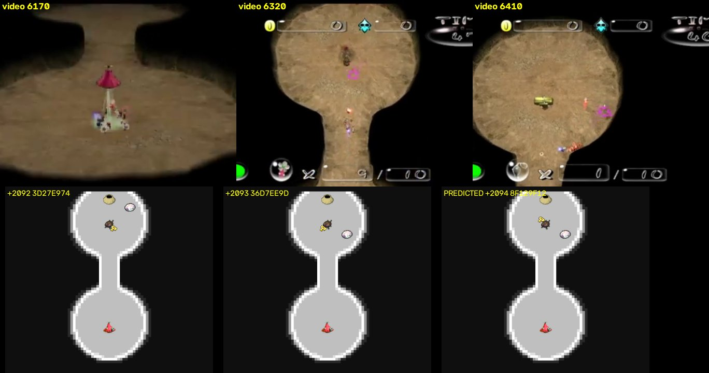
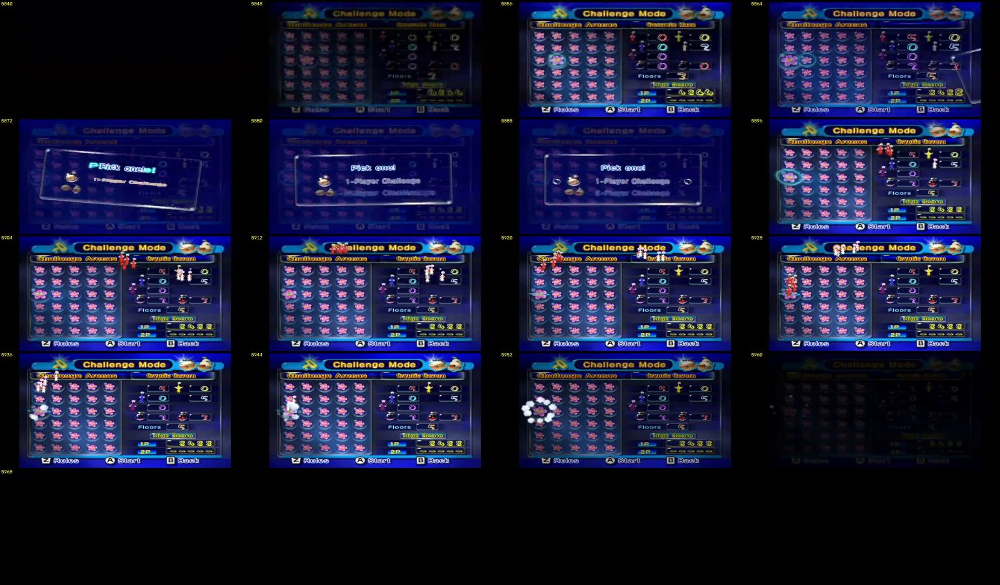
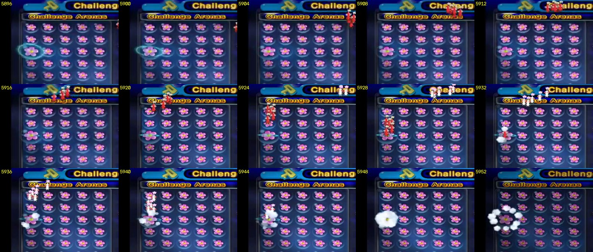
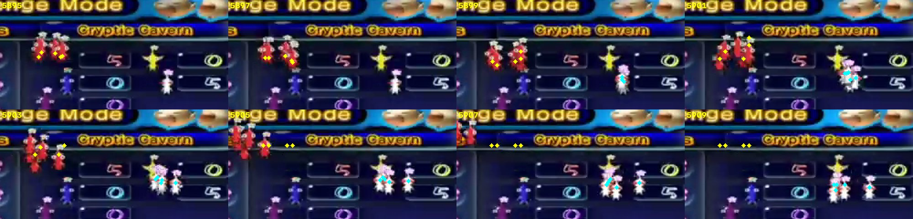

# Challenge Mode seeds from video

**Verdict: not feasible with the falling-letter method, feasible in two other ways for each
stage's first floor.**

1. **The results-screen score roll** (§3–§4) gives the RNG state after a stage. The next stage's
   floor 1 is that state + 1004 + (menu flashes).
2. **The Pikmin dive on the stage select** (§7–§8) is 1000 draws made right before floor 1 is
   generated. It reads the seed on its own, even when no roll comes before it: a run's first stage,
   and single-stage score records. **But it is not reliable yet.** The first version found 7 of 13
   dives on the reference run and was wrong at margins up to 23.6% (the CH10 record), because
   pruning dropped the true state before the exact comparison (§8). The current version keeps
   each state's best loss over several dive-start offsets and finds 10 of 13; every read with a
   10% margin or more (6 of 6) is correct, but the sample is small. Only reads confirmed by a
   results roll are published.

Floors 2+ have no RNG readout in the video. They are bounded to a window of 20k–1M states (§9);
finding them would need a layout matcher, which isn't built. The Switch release (Pikmin 2 HD) uses
a different RNG and is out of scope.

## 1. What a challenge floor shows on entry

The same floor-title screen opens (cave name + "Sublevel N"), but the name **does not fall**. It
fades in at its final place, red flame particles burn around it, and the letters pulse in size in
place.


Measured on Concrete Maze 1 (frames 150–310, 480p): the letters' bottom edge stays on row 128 from
the first visible frame to the fade-out, and the top edge moves ±5 px with the pulse. A story-mode
title at this size falls about 120 px from the top of the screen.

Decomp (`pikmin2-decomp/src/plugProjectOgawaU/ogObjFloor.cpp`, `ObjFloor::doCreate`): story caves
(`isFLOOR()`) build their title as `TitleMsgDrop`, while challenge ids `c_00`–`c_29` (`isCHALLENGE()`)
build it as `TitleMsgWave` (the enum names in the decomp are swapped). `TitleMsgDrop::init` draws
`randFloat() * 5` per letter; `TitleMsgWave` (`ogTitleMsg.cpp`) never calls `rand()` (a sine wave
plus a `ScaleMgr`). Challenge mode reaches this screen through `VsGame` `LoadState::exec`
(`vsGS_Load.cpp`, `open_Floor` with id `c_%02d`), and the VS-only rule rand (`isVS()`) is skipped.
**So the challenge title carries no RNG information at all.** That is not a detector problem.

## 2. Does the existing detector run on it?

- `p2seeds analyze` on the first 4 minutes of the 2-player GC run finds all 5 title screens as entry
  candidates, but recognizes none of them (best story cave 0.36–0.38).
- `docs/challenge_mode_probe.py` adds the 30 challenge names. Then "Concrete Maze" (CH12) is
  recognized at 0.37 (runner-up "Cave of Pain" 0.28, so the margin is fine; the score is low
  because of the flame glow). The font is the same, so no new templates are needed. 9 of 13 letters
  track, but each moves at most 2–4 px (6.5 for "z") over about 100 frames. `fit` stops with
  "too few letters with a usable fall", as the decomp predicts.
- Both runs were repeated after merging `detection-page-and-tuning` (its new `track.py` pair
  tracking included), with identical results.

## 3. What does carry the RNG: the results-screen score roll

After a stage, `TChallengeResultCounter::update` (`plugProjectMorimuraU/challengeResult2D.cpp`)
rolls four counters: pokos, Pikmin, time bonus and total. Every frame, each digit not yet locked is
`randInt(9) + 1` from the global RNG, ones digit first, in that counter order. One clean frame
shows up to 14 consecutive draws. This is the same signal CaveGen's real-time challenge-mode manip
reads (`Seed.java` `digit_observation`, `sequence_to_seed`; `Manip.java`).


Read by eye from 480p VODs, then put through `java -cp CaveGen.jar Seed seq2seed`:

| run / frame | digits (draw order) | seed |
|---|---|---|
| 2P GC 6590 | 5817 187 562 6228 | `423CDA79` |
| 2P GC 6589 | 1537 861 333 2557 | its 14 draws sit directly before 6590's, with 1 misread digit |
| 2P GC 13500 / 13506 | 6336… / 6198… | `51D44787` / `5416C4D3`, **84 = 6 × 14 draws apart** |
| solo Wii U 5649 / 5650 | 2586 339 238 6766 / 1311 898 938 8272 | `0F26C79E` / `04047550`, **14 draws apart** |

Later frames, where only the total is still rolling, land in the same stream (4 draws per frame,
then 3, 2 and 1 as digits lock). That pins the draw where the roll ends: about 1090 draws after
`04047550` in the solo run, and about 1195 after `51D44787` in the 2P run.

## 4. Seed → floor-1 layout, checked with CaveGen3

As in CaveGen's manip, the next stage's floor-1 layout seed is
`roll_end + 1004 + k`, where k is the number of slow menu advances between the results fade and
starting the stage. Each advance takes 16–286 frames (`seed_duration`); the first takes
`seed_duration_first`.

Solo run ([tcbtrio, Wii U VC USA, 56:05](https://www.youtube.com/watch?v=0Wa5r0jQBAc)):
- The roll ends at stream index 1090: the last draw is the thousands digit '9' that appears at frame
  5763, and the display never changes after that.
- The stage was started about 120 frames after the results fade (black at 5838, stage fade at about
  5958). The first menu advance would come 192–269 frames after the fade, so k = 0.
- That predicts Cryptic Cavern 1 (CH11-1) = `04047550` + 2094 = **`8F129F12`**.



The video matches the prediction: the pod is alone in its room, and the far room has the doodlebug
high up near the hole and the diamond right of centre, below it, where the player sends Pikmin
(frame 6410). The neighbours differ visibly: +2092 has the diamond top-right by the hole, and +2093
has the doodlebug lower. CH11-1 is a simple floor (two rooms, one teki, one treasure), so this is
consistent evidence rather than proof. A multi-room floor would confirm it better.

Also: the two 2P results screens are only 28,058 draws apart across the 5-floor Cryptic Cavern
stage. Floors 2+ are bounded to a window that small, but the video gives no readout inside it.

## 5. What supporting it would take

1. **New event type**: detect the results screen (blue panel, "Results!") instead of the title.
2. **Digit reader**: about 10 digit templates for the results font. This is a slot-roll font, not
   the HUD digits; `digits.py` is a starting point. Read the four counters per frame, ones digit
   first; locked digits are skipped (not drawn) and must be recognized as locked.
3. **Seed search**: the digit observation is affine in the RNG, like the letters, so `lattice.py`
   can take digit intervals (width 1/9) instead of velocity intervals, or call CaveGen's `seq2seed`.
   Chain consecutive frames (exactly N draws apart) to confirm, as `chain.py` does.
4. **Roll end and menu timing**: track the roll until it locks, measure fade → stage start in game
   frames, and walk `seed_duration` to get k. Then the layout is `end + 1004 + k`.
5. **Cave table**: challenge ids `CH1`–`CH30` (CaveGen3 names them `CH11-1` etc. and generates them;
   `caves.py` needs English names for the stage order and labels, see the probe).
6. **Verification**: compare the landing view (CaveGen3 `--view pod`) with the video, since there is
   no second independent reading of the same seed. The ±2-draw uncertainty at the roll end means a
   few neighbours must be ranked.

Limits:
- No floor 2+ seeds.
- No seed for the run's first stage, which has no preceding results screen.
- 2-player runs are split screen (harder to verify, though the digits read the same).
- The solo run here is the Wii U VC release ("New Play Control!" in its splits). Its roll and
  CaveGen3's `pikmin2` data agreed on this floor.

## 6. RNG on the menus before a stage is picked

The question: can something on the title screen, file select or challenge stage select read the
RNG for the stages the results roll can't cover (the run's first stage, floors 2+)?

**Verdict: no for the title, file select and flash; yes for the dive (see §7, which supersedes the
"not readable" verdict on the dive below).** The menus advance the global RNG, but only two things
there carry real information. The stage-select flash timer gives about 8 bits per flash, and a runner sees 0–1
flashes per visit. The stage-confirm Pikmin dive makes 1000 draws but can't be read at VOD
resolution. Neither pins a seed. The decomp does explain CaveGen's "+1004", which confirms the
menu → floor-1 link used in §4.

### Seeding

`System::construct` calls `srand(OSGetTick())` at power-on (`sysGCU/system.cpp:421`). Nothing
reseeds afterwards: no `srand` on file load, on entering Challenge Mode, or per stage (the only
other `srand` is the memory-card unlock's private LCG, `Dolphin/card/CARDUnlock.c`). So the RNG
carries over through everything since boot, including all gameplay.

### Per screen

| screen | global-RNG draws while showing (decomp) | visible? | verdict |
|---|---|---|---|
| Boot | `srand(OSGetTick())` | no | unknowable |
| Title / Press Start | `ebiScreenPushStart.cpp:142` one `randEbisawaFloat` per loop (picks 1 of 4 screens, 2 bits). Title-scene Pikmin `ebiP2TitlePikmin.cpp:518–541,665`, Chappy `ebiP2TitleChappy.cpp:211–227`, Kogane `ebiP2TitleKogane.cpp:192–204` and `ebiP2Title.cpp:193,548,571,732` draw on spawn and on each AI state change (speeds, wait timers, turn angles) | yes, dozens of small agents on a chaotic simulation | not readable in practice; also not in run footage (see below) |
| Title menu | `ebiScreenTitleMenu.cpp:308`: one draw per highlight cycle, `< 0.2` shows a sparkle (about 0.7 bits) | yes | far too little information |
| File select | none (`ebiFileSelectMgr.cpp`, `ebiScreenFileSelect*.cpp` have no `rand`); Challenge Mode does not go through it | — | nothing to read |
| Challenge stage select, created | `TChallengeSelect::doCreate` (`plugProjectMorimuraU/challengeSelect2D.cpp:1387,1402`): `TChallengePlayModeScreen` ctor 3 draws (`mAngleTimers`, the "Pick one!" swing phases, :680), then `TChallengeScreen` ctor 1 draw (first flash delay `300·r` frames, :518) | swing phase: only during "Pick one!", about 20 frames | not enough |
| Challenge stage select, idle | `TChallengeScreen::update` (:600–620): after each highlight flash, the next delay is `300·(0.9r + 0.1)` frames, one draw per flash. This is exactly CaveGen's `seed_duration` / `seed_duration_first` (`Seed.java:628–635`) | the highlight on the stage panels (`Nhl_00`–`Nhl_14`) | about 8.1 bits per frame-timed flash (270 possible delays); pinning 31 bits needs about 4 consecutive flash gaps, which is 20+ s idle on the menu |
| Stage confirm (dive) | `TChallengeSelect::jumpStart` → `TChallengePiki::jumpStart` (:75–96): 5 colours × 50 Pikmin × 4 `randFloat` (start delay 0–0.1 s, x deviation ±30 units, its sign, y deviation 15–25) = **1000 draws** | in theory | lots of information, but not readable from these videos (below) |

### What the footage shows

- **Neither run shows a title screen or file select.** The solo video opens on "Continue / Give Up"
  from an earlier attempt (frames 0–30) and goes straight to the stage select (frame 100). The 2P
  video opens on the stage select. A run's first stage therefore follows a give-up, after gameplay,
  so the RNG at that point is unknown.
- **Time on the stage select is about 4 s per visit.**
  - Solo, after stage 1: the results fade out at 5838, the menu is visible at 5850, the cursor moves
    and A is pressed at about 5866, "Pick one!" shows 5869–5888, the dive runs 5895–5955, and the
    stage starts at 5964.
  - Solo, run start: menu at 100, "Pick one!" 115–135, dive 136–200.
  - 2P before Snack Pit: menu fades in about 13716, "Pick one!" about 13746–13764, dive 13770–13836.
  - So the panel is on screen for about 45–60 frames before A. The first flash comes `300·r` frames
    after the menu is built, so a typical visit shows 0 flashes, sometimes 1.
- **No flash was seen.** In the 2P Snack Pit visit, the known seed puts the first flash 107 frames
  after the menu was built (about frame 13817, during the dive). No change shows on the flower grid
  in frames 13796–13840, and the solo menu visits show none in the grid-brightness trace. The
  highlight is subtle at 360/480p (the solo VOD is 640×360). Even a visible flash gives one 8-bit
  reading.
- **The dive is not readable.** The Pikmin are about 6 px tall and fly in tight single-file queues
  per colour, overlapping (solo frames 5900–5952, 2P frames 13796–13836). The start delay (≤ 3
  frames) and ±30-unit scatter of one Pikmin can't be separated from its neighbours'. A clean,
  full-resolution capture might do it: 1000 draws ending exactly at floor-1 generation would pin
  the seed with no timing involved. That would be its own research project, and these VODs can't
  support it.





### Menu → floor 1 (this confirms §4)

From the results roll's end L, in order: the menu is built (4 draws: 3 swing phases + first flash
delay), then k flash draws, then the dive (1000). Floor 1 is generated from **L + 4 + k + 1000**,
which is CaveGen's `next_seed(lastReadSeed, 1004)` with timer seed `L + 4`. The CH11-1 check in §4
(k = 0, `8F129F12`) is this chain. One unchecked case: a flash timer that runs out during the dive
(as predicted for the 2P Snack Pit visit) would make its draw after the dive's, if
`TChallengeScreen::update` keeps running in the demo. That would shift floor 1 by +1. Rank ±1
candidates when that happens.

### What stays out of reach

- The run's first stage: it follows a give-up, and the only readout before it is the unreadable
  dive.
- Floors 2+: no menu between floors.

## 7. Reading the seed from the Pikmin dive (prototype: works on one dive)

§6 called the dive unreadable. Closer work shows it can be read, at least for a small dive. On the
solo run's dive into Cryptic Cavern, the seed was recovered from the video **without using the
score roll**, and it is the same seed §4 found and checked against CaveGen3.

### What each draw does on screen

From `TChallengePiki::jumpStart` / `update` (`challengeSelect2D.cpp:75–200`). Pikmin *i* of colour
*c* (red, yellow, blue, white, purple) gets 4 draws:
- launch timer `T0 = 0.1·r₀ − 0.1·i − 0.5·c`
- sideways deviation `dx = 30·r₁`, negated when `r₂ > 0.5`
- hop height `dy = 15 + 10·r₃`

The timer advances 0.15 per frame. While it is in [0, π/2] (about 10.5 frames), the Pikmin hops
sideways: `x = X₀ − dx·sin t`, `y = Y₀ − |dy·sin 2t|`. It then climbs 12 units per frame at
`X₀ − dx` up to y = 100, and arcs to the stage panel.

Only the stage's starting Pikmin are moved and drawn (`mMaxPiki`, at most 50 per colour), but all
5 × 50 × 4 = 1000 draws are made regardless. Cryptic Cavern starts with 5 red and 5 white, so 10
Pikmin are visible.

The draws in game order are: last visible roll digit at s₁₀₈₉, then 5 more draws (s₁₀₉₀–s₁₀₉₄),
then the dive s₁₀₉₅–s₂₀₉₄, and floor 1 is generated from s₂₀₉₄ = `8F129F12`. This matches CaveGen's
`lastRead + 1004` exactly. §6's count of 4 menu draws left out one draw, whose source isn't pinned
down; the high-score slot's `randInt(6)` in `challengeResult2D.cpp` is one possibility.

### Evidence

- **Qualitative.** Each Pikmin uses 4 draws, so shifting the dive start by 4 moves every Pikmin
  over by one. Of offsets +1086…+1101 from `04047550`, only +1095 puts the red group 2 left /
  3 right and the white group 4 left / 1 right, as in the video.
- **Image fit.** The model renders a sprite template (cut from the video) at each simulated
  position, against background-subtracted frames 5893–5911. Scale, group origins, climb length and
  frame phase are fitted per hypothesis, within bounds.
  - +1095 scores 8731.
  - The 16 neighbouring offsets score 10712–15403.
  - 20 random seeds score 10113–13505.



The climb-and-arc part (from about frame 5905 for red) isn't modelled; only the hop and climb are.

### Seed-free recovery (`docs/challenge_dive/divemeasure.py`)

1. **Geometry**, fixed from the calibration fit: 0.88 × 0.65 px per unit, the red and white group
   origins, and the frame phase. These are properties of the capture layout. The tally icons sit at
   the same place on every stage, so in a run they can come from any dive whose seed the score roll
   already gives. Here they came from this same dive; see caveats.
2. **Measure each Pikmin freely**: launch jitter, signed sideways deviation and hop height, by
   differential evolution against the frames, with identity taken from launch order.
   - Sideways deviations came out within 0.7–3.9 units (red) and 0.1–1.3 units (white) of the truth.
   - All 10 directions were right.
   - Launch jitter and hop height are not measurable at 360p.
3. **Lattice search** over all 2³¹ states (`lattice.box_points`). Each |dx| bounds draw 4i+1 to
   ±4.5 units, and the direction bounds draw 4i+2 to half its range. 15 states satisfy all 20
   constraints (116 s), including the true one.
4. **Rank** the 15 by the image fit with the calibrated geometry. The true state comes first:
   8732, against 9328 for the next. That gives dive start `7CF9494B` and floor-1 layout seed
   **`8F129F12`**, the one verified against CaveGen3 in §4.

Synthetic check: with exact or σ = 1 noisy deviations and ±2.5 units, the lattice leaves about 30
states and the direction signs leave exactly the true one, in under a second.

### Caveats and what's next

- **One dive, one video.** The geometry calibration came from the same dive. A proper test is to
  calibrate on another stage of the run (its seed from the score roll) and recover a different
  dive. The frame phase must also be found per dive (from the first hop frame) instead of fixed.
- **The margin is modest:** 6% to the second candidate. Rendering the remaining candidates' floor 1
  with CaveGen3 and comparing with the landing view would settle close calls.
- **Crowding.** 5 per colour is a small dive. Bigger stages have up to 50 per colour, launched
  0.67 frames apart, so they overlap much more. The first few Pikmin of each colour are still the
  cleanest, and about 10 sideways deviations are enough.
- **2-player runs:** the dive is drawn once (no split screen), so the method should carry over, but
  it is untried.
- **What it adds:** the run's first stage, which follows a give-up and has no score roll before it.
  On later stages it gives an independent check of the roll and pins the ±1 draw. Floors 2+ are
  still out of reach.

## 8. The dive reader at scale: several runners, and the score WRs

§7 worked on one dive. This section turns it into a pipeline
(`p2seeds/src/p2seeds/challenge_dive.py`, scripts in `docs/challenge_dive/`) and tests it across
runners, against the score rolls.

### Pipeline (`challenge_dive.read_dive`)

1. **Menu visits:** frames showing the stage select (blue with pink flowers). One pass takes about
   1.5 minutes per hour of video.
2. **Registration:** a scale-and-shift match of the menu against a reference frame (cmal04 frame
   11792), with separate x and y scales. This places the five tally icons, the 5×6 stage grid and the
   sprite scale on any capture layout (Wii/Wii U 16:9; GC 4:3 to be tested).
3. **Stage:** the panel where the dive lands (its white flower burst). For WR videos the stage comes
   from the record.
4. **Starting Pikmin per colour:** CaveGen3's `challenge_stages.csv`. The dive draws only
   `mPikiCounts[c]` Pikmin per colour, at most 50 (`challengeSelect2D.cpp:2111`).
5. **Observations:** for each frame, the difference from the per-pixel median over the dive (each
   pixel shows a Pikmin only briefly). Frames dominated by the "Pick one!" window are dropped.
6. **Frame phase f0:** a search over the whole menu visit. Motion onset can't be trusted, because
   the "Pick one!" window is still sliding away when the dive starts.
7. **Candidate states:** either all 2³¹ states (numba kernel: about 3.9 s per 16M states for 6
   Pikmin, so about 8 minutes), or, when a later results roll is decoded, only the states whose
   floor-1 seed lies within a window before that roll's first state. Every CMAL stage consumed
   18k–183k draws from the floor-1 seed to the next roll, so a window of 3 million is safe.
8. **Scoring:** a cheap lookup score at each Pikmin's late-hop positions, then a compiled
   full-image loss (half resolution, every other frame, about 30 s per 200k states) on the best
   400k, then the exact image loss on the best 2000.
9. **Geometry refit:** refit scale, origins, frame phase and landing panel on the leader, then
   prune and re-rank again with the refitted geometry. This step matters: a look-alike state (one
   whose 10 Pikmin are all within a few units of the truth) can win with fixed geometry, but the true
   state is the one that lines up exactly once the geometry is refined. On Cryptic Cavern the
   fixed-geometry loss was 21,712 for the impostor against 22,247 for the truth; after refitting it
   is 26,620 against 11,543.
10. **Floor-1 layout seed** = the state after the dive's 1000th draw. Bit 31 never reaches
    `rand()`'s output, so seeds are given in 31 bits.

The dive begins **5 draws after the last draw of the previous score roll**, as defined by the roll
reader's `state_after_last_draw`. That holds for both hand-checked cases (Cryptic Cavern, Snack Pit),
and then the floor-1 seed = that state + 1004, matching CaveGen's constant.

### Score-roll reader (`p2seeds/src/p2seeds/challenge_results.py`)

Built by a helper agent and checked against the hand-read values in §3–§4. On 9 videos it decoded
274 of 306 results screens. Rolls in cmal09 (spark573, Wii) are partly blended frames, so only 14 of
30 decoded. **The Switch release (Pikmin 2 HD) does not use the GameCube/Wii random-number generator
or digit mapping**: its digits read cleanly, but no GC/Wii RNG state explains them under any of the
48 orderings tried. Switch runs are out of scope.

Online search (Nov 2026) found no public reverse engineering of the Switch port's RNG. Switchbrew
lists Pikmin 1+2 under Nintendo's GC/Wii emulator "hagi", and Pikmin Wiki says the port is built from
the North American New Play Control! (Wii) release. If the CPU code is that Wii build translated
ahead of time (as for Super Mario Sunshine), `rand()` is probably the same LCG, and the mismatch would
come from the Wii build's results-screen code or extra draws. That is a guess. Checking it would mean
disassembling the NPC `main.dol` (not decompiled publicly) and reading its `rand`/`randInt` and the
results counter, or testing the NPC Wii runs here: cmal09 (spark573, Wii JPN) decodes with the GC model.

### Cross-check against the rolls (`docs/challenge_dive/crosscheck_cmal.py`)

For each stage between two decoded rolls, the dive is searched using only the **following** roll
(a window of 3M states). The result is then compared with the truth from the **preceding** roll
(its end + 5). The two sources are independent.

Checked against a truth from a decoded results roll (all on the solo Wii U run cmal04 unless
noted). The pipeline changed during the day; each result is labelled with the version it ran on.
A second CH29 visit is excluded: another menu visit came between it and the preceding roll, so
"roll end + 5" is not its dive start (`truth_valid` in the data).

- **Current pipeline** (`crosscheck_cmal.py --every 2`, then 10 visits rerun with the current reader, `--tag _f0`; data in `data/challenge/crosscheck/`): 10 of 13 correct; 6 of 6 with a margin of 10% or more.

| run | stage | Pikmin | result | margin | earlier pipeline |
|---|---|---|---|---|---|
| cmal04 tcbtrio | CH11 | red 5, white 5 | **correct** | 59.9% | (not rerun) |
| cmal04 tcbtrio | CH21 | red 30, blue 30 | **correct** | 18.2% | wrong, 4.4% |
| cmal04 tcbtrio | CH27 | red 50 | **correct** | 41.1% | (not rerun) |
| cmal04 tcbtrio | CH29 | yellow 30, purple 20 | **correct** | 11.8% | wrong, 12.5% |
| cmal04 tcbtrio | CH29 | yellow 30, purple 20 | no truth (another menu visit since the last results screen) | 0.1% | |
| cmal04 tcbtrio | CH22 | red 20, yellow 20, blue 20 | **correct** | 39.8% | (not rerun) |
| cmal04 tcbtrio | CH18 | red 25, blue 25 | wrong | 5.9% | correct, 6.2% |
| cmal04 tcbtrio | CH20 | blue 50 | **correct** | 5.4% | correct, 8.8% |
| cmal04 tcbtrio | CH14 | red 25, yellow 25, blue 25, white 25 | **correct** | 9.3% | wrong, 0.3% |
| cmal04 tcbtrio | CH8 | red 40 | **correct** | 48.0% | wrong, 8.8% |
| cmal04 tcbtrio | CH10 | yellow 50 | **correct** | 7.3% | correct, 8.4% |
| cmal04 tcbtrio | CH4 | blue 50 | wrong | 1.8% | wrong, 3.9% |
| cmal04 tcbtrio | CH2 | white 30 | **correct** | 8.7% | correct, 9.5% |
| cmal04 tcbtrio | CH6 | red 1, yellow 1, blue 1 | wrong | 0.9% | (not rerun) |

The rerun fixed CH21, CH29, CH14 and CH8 and lost CH18 (correct at 6.2% before, wrong at 5.9% now). Both remaining wrong reads with a truth have margins under 6%; correct reads still go as low as 5.4%, so a low margin means "don't know", not "wrong".

- **Earlier versions** (same dives, without the later frame-phase and pruning fixes):
  - CH16 Snack Pit (5 of each colour): found from scratch over all 2³¹ states, 13.6% margin.
  - CH29 (30 yellow, 20 purple): correct, 22% margin.
  - CH26 (4 red): wrong, margin under 2%.
- **A WR video:** CH28 (spark573, 25 purple) opens on the previous attempt's results roll. The
  reader's best state is exactly that truth (`4AA0C7DC`, layout `29549C67`), but with only a 1.3%
  margin, so on its own it would not have been published.

**The margin is not a confidence measure.** Correct reads range from 6% to 60%; wrong ones from
0.1% to 12.5% (CH29). Running CH29 again with the true state scored alongside (`read_dive(...,
probe=[truth])`): the truth fits **19% better** than the reported winner, but it ranked about
106,000th on the coarse half-resolution loss and was cut before the exact comparison (only the
best 20,000 go on). The winner then "wins" against other wrong states. On the score records, the
CH10 read (23.6% margin) gives a layout that does not match the video, and none of the next 3
seeds after it do either, so the dive state itself is wrong there.

So the site now publishes **only reads confirmed by a preceding results roll** (CH28).
`make_site_seeds.py --allow-unverified` restores the old margin rule (beat every non-shift
competitor by 10%, beat its own shifts, at least 8 visible Pikmin) for experiments.

**Fix: start-offset pruning.** The truth only wins once the geometry and dive start frame are
refit, and the start frame from the first estimate is often 1–3 frames off. Pruning now keeps each
state's best coarse loss over dive-start offsets of −3, −1.5, 0, +1.5 and +3 frames (−1.5..+1.5 after
the first refit). On CH29 the truth then ranks first at the coarse stage instead of about
106,000th, and the read is correct. The final ranking and the geometry fits use a compiled exact loss
(equal to the Python one to 1e-8, about 4× faster per evaluation, fits run in parallel), so the
extra offsets cost no more time than before: about 10–20 minutes per dive on an idle machine.

Per-stage RNG use is consistent between runners
(`p2seeds/src/p2seeds/data/challenge_stage_draws.json`: draws per video frame from the floor-1 seed
to the next roll, 6 CMAL runs). For example, CH6 uses 5.4–7.0, CH11 3.3–4.2 and CH26 8.9–16.6. For
dives with few Pikmin, the window is narrowed to (frames from the dive to the results) × the stage's
rate, ±35%.

### Detection reader with the game's own sprites (`dive_detect`, `docs/challenge_dive/read_det.py`)

An alternative scorer that detects Pikmin in the video instead of comparing a grey rendering.

**Sprites.** The sprites are taken from the disc (`docs/challenge_dive/extract_sprites.py`:
`new_screen/eng/res_challengeSelect.szs`, `challengemodo_select.blo`). Each dive Pikmin is three
panes, following `TChallengePiki::draw` in the decomp:
- an invisible pane;
- the mirrored body `new_X_pikmin.bti`;
- `flower_icon.bti`, tinted magenta→white for white and purple Pikmin.

**Detection.** For each colour and frame, masked normalised cross-correlation at three scales,
times the fraction of the sprite area that differs from the background. A compiled kernel then
follows each state's trajectory and sums the response maps at the predicted anchors. The geometry
starts from the grey reader's fit, is corrected by where the waiting stacks are detected, and is
then refit per state.

**Which part to detect** (CH28 WR, truth known). Truth lead over the best other fitted state, in
SDs of random states:

| Detected part | Truth lead (SDs) |
|---|---|
| body + flower | 1.7 |
| body | 3.7 |
| flower | 6.4 |

The flower is small, is drawn over its own body, and stands out against the menu. Red, yellow and
blue share the same flower, though.

**Results.**
- **CH28 WR, blind:** the flower reader ranks the truth `CAA0C7DC` first in its 6M window, with a
  38% margin (grey reader: 1.3%).
- **CH10 WR:** no clear read. The whole window gives a 2.7% margin. Restricted to the 7.5% of
  states with the gold medal at the spawn point nearest the pod (`itemscan`), the margin is 1.3%.
- **cmal04, 13 dives with a results-screen truth** (`crosscheck_det.py`). Each starts from the
  grey reader's geometry.

| Detection run | Flower correct | Grey correct | Notes |
|---|---|---|---|
| Truth added to the refit set | 6 | 9 | Flower's margin is calibrated: every margin ≥ 9% correct, every wrong one < 3.5%. Fixes CH18. |
| Blind: flower re-ranks the grey shortlist (`--grey-shortlist 60 --blind`) | 5 | 9 | Margin no longer calibrated: CH20 wrong at 11%, and CH11, CH4 and CH6, whose truths are not in the shortlist, show 10–36%. |

  Flower's own first pass (window scoring at the unrefined geometry) ranked the truth among its
  first 60 in only 4 of 13 dives. Wrong flower reads are mostly stages with two or more of red,
  yellow and blue (CH21, CH14), plus CH29 and CH10.

**Improvements tried** (`docs/challenge_dive/det_eval.py`: grey reads are cached, so a variant is
scored on every truth-known dive in about an hour; `--blind` leaves the truth out of the state set).

| Change | Effect |
|---|---|
| **Reverse term** (`back_w`): every flower detection in a frame earns its value × exp(−d²/2σ²), d = distance to the nearest predicted Pikmin that could be that colour. It penalises states whose Pikmin are not where the flowers are, not only rewarding states whose Pikmin land on flowers. | cmal04: 5 → 7 of 13 correct (truth in set); on the 10 dives whose truth is in the grey shortlist, the pick is the truth or one Pikmin away (±4 draws) on all 10. cmal13 blind: 4 → 6 of 14 (7 within 4 draws). Used from here on (`back_w` 2, σ 3 px). |
| Fade frames (more than 45% of the region changed) dropped | Removed about 80 junk detections per fade frame. |
| Body colour under each flower (red/yellow/blue share a flower) | The colour maps look right mid-dive; not yet evaluated. |
| One-Pikmin shift resolution: refit state ± 4j draws and compare | **No gain.** Picks move both ways (CH10 fixed, CH8 and CH14 broken). Scoring only each colour's first 1–3 Pikmin at a fixed geometry picks from −16 to +16. Dropping the landing phase helps only when started at the truth. A shift changes one or two trajectories out of 20–50, which is below the noise. |
| f0 scanned in 0.1-frame steps instead of Powell (the score is a step function of f0) | Each state fits better, but so do wrong ones: cmal04 blind 7 → 4. Kept as an option (`fit(f0_scan=True)`), off by default. |
| Neighbours of the leaders (±1–3 draws) refit | cmal04 CH4's grey candidates are the truth +1, −3, +5 draws (a one-draw shift), so expansion adds the truth, but detection ranks it 24th. |

**Two videos, blind, reverse term:**

| Video | Dives (truth in grey shortlist) | Grey correct | Detection correct | Either correct | Grey and detection agree |
|---|---|---|---|---|---|
| cmal04 (Wii U) | 13 (10) | 9 | 7 | 11 | 7, of which 6 correct |
| cmal13 (GC) | 14 (14) | 9 | 6 | 10 | 5, all correct |

On cmal13 the grey reader gets 9 of all 27 dives right; the 14 in the table are those whose truth it
shortlists. Detection's own margin is only partly calibrated (cmal13: 6 of 9 with margin ≥ 8%
correct).

**Verdict.** Detection is not better than the grey reader overall, but the two are complementary:
- When they agree, the read is almost always right (11 of 12).
- One or the other is right on 21 of 27 dives.
- Detection's misses are mostly one-Pikmin shifts or dives with few Pikmin (CH6 1/1/1, CH11 5+5).
  These need a layout check of the candidates on floor 1 rather than better tracking.

Not done:
- a geometry fit from the detections alone;
- scale and v100 per video (sy wanders 0.54–0.71 between stages of one video);
- the body-colour evaluation.

### Anchored reading: the seed after the stage is known (`docs/challenge_dive/anchored_eval.py`)

This is the case that matters in practice: the results roll after a stage gives an anchor state,
and the dive's first state lies 18.8k–184k draws before it (median 54k; stage length does not
predict the distance). The reader searches that window only.

What changed against the pipeline above:
- **Dive start frame from the "Pick one!" window.** The start frame is taken from the last frame
  of the window closing (`closing_end`); the true start is 6.5–9.5 frames before it on 64 dives.
  The old search locked onto the menu fade-in when the runner picked the stage at once; that was
  the whole failure on cmal08 and cmal11 (0 correct before).
- **One menu registration per video** from the pink flower grid (`register_grid`,
  `video_registration`), language independent. Per-dive registration gave wrong stage IDs.
- **Speed.** Coarse prune at quarter resolution over 5 start offsets, half-resolution pre-rank of
  500, nearest 110k draws first with early exit on a clear margin (≥ 5%).
- **Detection only on unclear grey reads**; it wins only with its own margin ≥ 10%.
- **Stages with ≤ 15 Pikmin** are read over the whole window at once.

Results on all six downloaded videos, 159 dives. "Truth" is the previous results roll's last
state + 5.

| Video | Dives | Exact | 1–2 draws late | Off by whole Pikmin (±4, ±8, ±12) | Other miss | Mean s/dive |
|---|---|---|---|---|---|---|
| cmal02 (Wii U, JPN) | 28 | 22 | 3 | 1 | 2 | 308 |
| cmal04 (Wii U, USA) | 26 | 17 | 2 | 2 | 5 | 342 |
| cmal08 (GC, JPN) | 26 | 16 | 2 | 2 | 6 | 392 |
| cmal11 (GC, JPN) | 26 | 13 | 5 | 3 | 5 | 461 |
| cmal13 (GC, USA) | 27 | 13 | 5 | 4 | 5 | 499 |
| cmal26 (GC, USA) | 26 | 13 | 3 | 1 | 9 | 819 |
| **All** | **159** | **94** | **20** | **13** | **32** | |

Times are with two videos running in parallel on 8 cores.

- **1–2 draws late (20 dives).** These land exactly 1 or 2 draws after the expected state, mostly
  with a clear margin. A wrong read cannot land that close by chance (states 1–3 draws apart are
  unrelated dives), so these are almost certainly correct reads and the game made 6 or 7 draws
  between the roll and the dive instead of 5. The cause is not identified. Counting them, 114 of
  159 (72%).
- **Whole-Pikmin shifts (13).** The same dive shifted by one to three Pikmin; mostly single- or
  two-colour stages (CH1, CH3, CH13, CH15, CH19). No reliable tie-breaker yet; detection fixes
  some and breaks others. Fixed since: see the next section.
- **Other misses (32).** CH6 (1/1/1) is missed on every video, CH26 (4) on four, CH28 (25
  bulbmin) on four; the whole-window rule for small stages did not rescue them. cmal26 has the
  most misses and the slowest reads (17 of its 26 grey reads were unclear); not yet looked into.
- **The margin was not a usable confidence** (it is after the fix in the next section). 127 reads were "clear"; 80 exact, 20 late, 27
  wrong. A layout check of the top candidates against floor 1 is the likely fix, as for the
  detection reader.
- Detection changed the answer for the better on 4 dives (cmal11 +1, cmal26 +3) and for the worse
  on 2 (cmal04).

### Why the anchored reader missed, and the fix (`miss_diag.py`, `final_rank_test.py`, `cross_rank`)

The 45 dives not read exactly or 1-2 draws late were diagnosed one by one. `miss_diag.py` sets a
dive up as the reader does, then fits the true state, its neighbours from -16 to +16 draws and the
reader's pick directly, with no window search.

| Which state fits best when fitted directly | Dives |
|---|---|
| the true state | 20 |
| a one-Pikmin shift of it (+-4, +-8, +-12 draws) | 16 |
| the reader's wrong pick | 5 |
| the true state + 1 draw | 3 |
| another neighbour (+5, -3, -11) | 3 |

So on 20 of them the search had simply lost a state that fits best. The cached reads show how:

- **The final geometry fit is not repeatable.** Fitting the same state from two starting geometries
  gives losses 5-10% apart. The reader compared each candidate's own fitted loss, so the order of
  the leaders was partly luck. It also fitted the leader's one-Pikmin shifts separately and moved
  to a shift whenever one came out lower: each such fit was another chance to win. That produced
  the whole-Pikmin shifts. Refitting the same dives from one common start gave different shifts
  (first table above), which is the same effect.
- **Only six candidates were fitted.** The true state was often further down the fixed-geometry
  ranking (rank 7 to 80 on six dives) and never got its own fit.
- **Near and far halves of the window were combined by margin**, not by loss: on cmal13 CH30 the far
  read had the true state on top and the near read was kept.

The fix is `cross_rank` in `challenge_dive.py`, now the last step of `read_dive`:

- the search's top 12, the leaders of an earlier read of the same dive (the other half of the
  window) and the leader's one-Pikmin shifts are each fitted from the reference geometry;
- every candidate is then scored under every fitted geometry, at start offsets of 0, +-1 and +-2
  Pikmin delays, and keeps its best. A geometry found for one candidate is available to all;
- the rest of the search's top 200 is screened at half resolution under the leaders' geometries and
  the best 8 join (150 on stages with at most 15 Pikmin, where fits are cheap);
- the three leaders' +-4 and +-8 shifts join, the eight leaders are fitted again from their best
  geometry, and everything is scored once more.

Results, re-ranking the cached searches of all 159 dives (`final_rank_test.py`; same setup, same
candidates as the reader had):

| Video | Dives | Exact | 1-2 draws late | Whole-Pikmin shift | Miss |
|---|---|---|---|---|---|
| cmal02 | 28 | 25 | 3 | 0 | 0 |
| cmal04 | 26 | 23 | 2 | 0 | 1 |
| cmal08 | 26 | 23 | 2 | 0 | 1 |
| cmal11 | 26 | 18 | 5 | 0 | 3 |
| cmal13 | 27 | 18 | 7 | 0 | 2 |
| cmal26 | 26 | 16 | 5 | 0 | 5 |
| **All** | **159** | **123** | **24** | **0** | **12** |
| before | 159 | 92 | 20 | 15 | 32 |

- 147 of 159 (92%) are exact or 1-2 draws late, against 112 before. No dive that was right before
  is wrong now. (The earlier table says 94 + 20; it counted the detection cross-check's picks.)
- **The margin is now a usable confidence** (less clean end to end, see below). Margin of the leader over the runner-up of at least
  5%: 120 dives, all 120 right. At least 2%: 141 dives, 138 right.
- The ranking step takes 1 to 8 minutes per dive, mean just under 4, with three videos in parallel
  on 8 cores. It replaces the old fit step.
- A first end-to-end check (`anchored_eval.py --tag x`, full window search with the changed reader)
  on 15 dives, 14 of them former misses, gave 15 of 15 exact. The full re-read follows.

**End to end, all 159 dives** (`anchored_eval.py --grey-only --tag x`: full window search and the
changed reader, no detection cross-check; results in `e2e_<video>.json`):

| Video | Dives | Exact | 1-2 draws late | Whole-Pikmin shift | Miss |
|---|---|---|---|---|---|
| cmal02 | 28 | 25 | 3 | 0 | 0 |
| cmal04 | 26 | 22 | 2 | 1 | 1 |
| cmal08 | 26 | 23 | 2 | 0 | 1 |
| cmal11 | 26 | 17 | 5 | 0 | 4 |
| cmal13 | 27 | 19 | 7 | 0 | 1 |
| cmal26 | 26 | 16 | 4 | 0 | 6 |
| **All** | **159** | **122** | **23** | **1** | **13** |

- 145 of 159 (91%) exact or 1-2 draws late, against 147 from re-ranking the cached searches. 155
  dives come out the same; four differ:
  - cmal04 CH2 (30 of one colour): exact when re-ranked, now one Pikmin late (+4 draws), with a
    margin of 10.6%. One whole-Pikmin shift is back.
  - cmal11 CH26 (4 Pikmin): exact when re-ranked, now missed, with a margin of 6.5%.
  - cmal26 CH4 (50 of one colour): 1 draw late when re-ranked, now -11 draws, margin 0.1%.
  - cmal13 CH26 (4 Pikmin): missed when re-ranked, now exact, margin 1.2%.
- **The margin is a weaker confidence than the re-ranking suggested.** Margin of at least 5%: 125
  dives, 123 right (the two wrong ones are cmal04 CH2 and cmal11 CH26 above). At least 2%: 141
  dives, 138 right. So a 5% margin is about 98% reliable, not certain.
- So the final ranking still depends somewhat on which candidates and geometries the search hands
  it: the same dive, re-read, changed its answer on 4 of 159.
- Time: mean 9.4 minutes per dive for search plus ranking (longest 33), three videos in parallel
  on 8 cores; about 8 hours for the 144 dives not already cached.

The lists below describe the re-ranked result; end to end the misses are the same dives except
for the four above.

The 12 that remain:

- 8 are stages with 3 or 4 Pikmin: CH6 (1/1/1) on four videos, CH26 (4) on three, and CH11 (5/5) on
  cmal11. On two of them the true state is among the fitted candidates and still does not win; the
  dive carries too little information for the fit quality we have. On cmal11 CH6 and CH11 the
  "Pick one!" window closing was not found, so the start frame is a guess.
- cmal11 CH28, cmal26 CH28, CH18, CH19: the true state did not reach the search's top 200 (three),
  or sits second by 0.3% (cmal26 CH19).

Open points:
- On six of the former misses a neighbour of the expected state fitted best in the direct test (+1
  on three, +5, -3, -11). After the fix four of them read 1 draw late and two are still missed, so
  the +5, -3 and -11 were fit noise. The 24 "late" reads remain unexplained.
- cmal26 is still the weakest video (5 misses, lower margins); not looked into.

### Floor-1 layout check (`docs/challenge_dive/floor_check.py`)

Tested whether the floor-1 picture can confirm or correct a dive read. After
the dive the game shows the first floor from overhead for about 25 frames
under the floor title. The script takes the three stillest frames of that
shot, subtracts the title-only frame before it, and scores candidate layout
seeds (dive first state + 999 draws) by how much of the lit area lands on
floor cells of the generated layout. Scoring uses `layoutmatch.exe floor2`
from the layout-matcher branch (`claude/layout-matcher-f38181`, see
`docs/layout-matcher.md`); the binary is not built on this branch
(`P2SEEDS_LAYOUTMATCH` points at it).

Each dive was scored at offsets −40…+40 draws around the true seed and against
20,000 unrelated seeds. All 159 dives of the six videos:

| outcome | dives |
| --- | --- |
| every seed scores the same (only the fixed start room is lit, or the floor fills the frame) | 73 |
| overhead shot not found (too short) | 12 |
| scores differ but do not pick out the true seed | 60 |
| one seed stands out (first of the 81 neighbours and in the top 200 of 20,000) | 14 |

The 14 are all on three stages: CH8 (5 of 6 videos), CH20 (6 of 6) and CH21
(3 of 6; the other 3 are near misses, described below). On the
other 27 stages the floor shape carries no usable information.

What the three stages show:

- The layout is at the expected seed in 12 of the 14, and one draw later in 2
  (cmal02 CH8, cmal04 CH20). Both of those dives were read exactly, so the
  extra draw came after the dive: a layout seed can sit one draw past what the
  dive implies.
- cmal08 CH21, where the dive was read one draw late: the seed one draw late
  ties for first of the 81 (with an unrelated offset, −28) and is 297th of
  20,000; the expected seed is 10th of 81. That favours the late read being
  the real state (an extra draw before the dive), but it is weak evidence
  from one dive.
- cmal26 CH21, where the dive read is 4 draws off (a whole-Pikmin shift): the
  floor scores the true seed 2nd of 81 (297th of 20,000) and the dive's pick
  well below it, so that shift is a real misread.

As a tie-breaker for the reader it is not worth wiring in: of the 45 wrong
reads only one (cmal26 CH21) is on a stage where the check works. A general
check would have to match objects (treasures, plants) in the overhead shot,
which the layout matcher currently does only with per-stage readings.

### Running it

```bash
# results rolls of a video (one JSON entry per results screen)
.venv/Scripts/python docs/challenge_dive/read_results.py VIDEO --out rolls.json
# every dive in a video (whole 2^31 search, about 8 minutes per dive on 8 cores)
.venv/Scripts/python docs/challenge_dive/read_dives.py VIDEO --out dives.json
# CMAL cross-check: dives searched near the following roll, compared with the preceding roll
.venv/Scripts/python docs/challenge_dive/crosscheck_cmal.py VIDEO --every 2
# score WRs (data/challenge/wr/: wr_list.json, videos, visits.json, rolls/)
.venv/Scripts/python docs/challenge_dive/run_wrs.py
.venv/Scripts/python docs/challenge_dive/make_site_seeds.py ../pikmin-wrs/site/seeds.json
```

Needs numba (`pip install numba`, installed in `.venv`) and CaveGen3's `challenge_stages.csv`
(found next to this repo, or `P2SEEDS_CAVEGEN3_DATA`).

### Score WRs (pik5.net, current Pikmin 2 #1s)

| stage | record| Pikmin | floor-1 seed | margin | shift margin | status |
|---|---|---|---|---|---|---|
| CH1 | 35,353 Gorei_50 | red 50 | `2C1ABE60` | 15.1% | +5.7% | withheld (margin rule only) |
| CH2 | 38,039 Gorei_50 | white 30 | `29334AE5` | 38.3% | +2.3% | withheld (margin rule only) |
| CH3 | 48,317 Gorei_50 | yellow 100 | `3CBFEB45` | 6.9% | +3.8% | uncertain |
| CH4 | 13,982 Gorei_50 | blue 50 | `1F8A1928` | 0.7% | +0.7% | uncertain |
| CH5 | 11,754 Gorei_50 | red 10, yellow 10, blue 10 | `7E0998D1` | 7.3% | +6.0% | uncertain |
| CH6 | 9,546 Gorei_50 | red 1, yellow 1, blue 1 | `21EB11C3` | 23.7% | +23.0% | uncertain |
| CH7 | 15,044 Gorei_50 | blue 50 | `65465192` | 0.1% | +0.8% | uncertain |
| CH8 | 18,883 Gorei_50 | red 40 | `24208D0E` | 1.2% | +6.3% | uncertain |
| CH9 | 50,902 Gorei_50 | red 40, white 20, purple 20 | `1A92224A` | 0.8% | +0.7% | uncertain |
| CH10 | 26,773 Gorei_50 | yellow 50 | `25EE5FBF` | 23.6% | +11.2% | withheld (margin rule only) |
| CH11 | 8,552 Gorei_50 | red 5, white 5 | `743EA7AC` | 1.0% | +0.8% | uncertain |
| CH12 | 4,994 Gorei_50 | white 2 | `2CB5DC24` | 0.0% | +18.5% | uncertain |
| CH13 | 48,415 Gorei_50 | white 50 | `79DEE351` | 72.9% | +23.2% | withheld (margin rule only) |
| CH14 | 18,355 albut3 | red 25, yellow 25, blue 25, white 25 | `1E828824` | 16.8% | +4.3% | withheld (margin rule only) |
| CH15 | 6,264 Gorei_50 | red 25, white 25 | `78F3DE3E` | 19.7% | +7.7% | withheld (margin rule only) |
| CH16 | 6,003 Gorei_50 | red 5, yellow 5, blue 5, white 5, purple 5 | `0615E706` | 54.3% | +65.9% | withheld (margin rule only) |
| CH17 | 16,700 Gorei_50 | yellow 30, white 15, purple 15 | `7F1CE063` | 29.5% | +17.0% | withheld (margin rule only) |
| CH18 | 54,082 Gorei_50 | red 25, blue 25 | `254CB07C` | 0.7% | +2.2% | uncertain |
| CH19 | 11,720 Gorei_50 | red 20, blue 25, purple 5 | `6913B1F6` | 2.5% | +1.2% | uncertain |
| CH20 | 15,599 Gorei_50 | blue 50 | `5D221DD2` | 21.3% | +4.5% | withheld (margin rule only) |
| CH21 | 35,441 albut3 | | | | | no stage-select dive in the video |
| CH22 | 14,437 albut3 | red 20, yellow 20, blue 20 | `3B82BBBD` | 1.4% | +0.2% | uncertain |
| CH23 | 10,044 kobachi_no_udon | | | | | not run |
| CH24 | 14,343 albut3 | red 30, yellow 30 | `0BD5B59A` | 0.4% | +5.0% | uncertain |
| CH25 | 28,031 Gorei_50 | red 10, yellow 10, blue 10, white 10, purple 10 | `22DE2928` | 0.3% | +3.1% | uncertain |
| CH26 | 32,803 Gorei_50 | red 4 | `3FE0B9E8` | 0.2% | +1.3% | uncertain |
| CH27 | 10,400 Bl6AltMzq5Jx4aM | red 50 | `5F14F7DF` | 2.1% | +0.2% | uncertain |
| CH28 | 32,742 spark573 | purple 25 | `29549C67` | 1.3% | +2.8% | published (confirmed by the previous roll) |
| CH29 | 33,362 Gorei_50 | yellow 30, purple 20 | `4A0376CD` | 18.6% | +18.2% | withheld (margin rule only) |
| CH30 | 32,248 Gorei_50 | red 20, blue 20, purple 10 | `29055A01` | 11.4% | +5.5% | withheld (margin rule only) |


The first pass published 12 of these from the margin rule; they were withdrawn after the CH10
seed was found wrong and the CH29 cross-check failed (above). The table is from the first
version of the reader; only CH10 has been rerun with the current one (below). Only CH28, confirmed by the previous
attempt's roll, is on the pikmin-wrs site (https://jhawk4.github.io/pikmin-wrs/en/seeds.html).
The other reads:
- **Withheld** (passed the margin rule only): CH1, 2, 10 (wrong), 13, 14, 15, 16, 17, 20, 29, 30.
- **Uncertain:**
  - Dense single-colour dives: CH3 (50 yellow), CH4 and CH7 (50 blue), CH8 (40 red), CH27 (50 red).
  - Mixed dives with small margins: CH5, CH9, CH11, CH18, CH19, CH22, CH24, CH25.
  - CH26 (4 red).

  Most of these records are Gorei's Wii captures, whose menus register less precisely than the
  reference run. The geometry refit then has more to recover, and dense trains leave it little to
  lock onto. CH11, for example, was decoded with a 60% margin on the reference run but only 1% here.
- **Too few Pikmin:** CH6 (3) and CH12 (2).
- **No dive in the video:** CH21 starts on floor 2.
- **No video:** CH23 (it also has no dive Pikmin).

Check images for each WR (CaveGen3 render of floor 1 next to frames of the video's first floor):
`docs/challenge_dive/wr_gallery.py`. Comparing by eye at video resolution is not a reliable check:
I judged CH10 to agree with its video, and it does not.

**CH10 rerun with the current reader** (`WR_DIVES=dives_f0 run_wrs.py 10`, data in
`data/challenge/wr/dives_f0/`): the best state is now `B0670AA8` (floor-1 seed `48E42063`), which was second in
the first version. The wrong first-version winner (`1B762954`, seed `25EE5FBF`) is no longer in the
top 6. But the new margin is only 1.2% (over `C80EBEBC`, seed `302A5EC7`), too small to call, so CH10
stays uncertain until someone checks `48E42063` against the video.


## 9. Floors after the first (stretch goal): not done, but bounded

No readout on screen carries the RNG between floors: the floor titles are `TitleMsgWave` (§1), and
there is no results roll or menu between floors. What we do know is a window:

- Floor *k* ≥ 2 is generated from a state strictly between floor 1's seed (known from the dive or
  the previous roll) and the first draw of the stage's results roll (known from the roll).
- That window is small:
  - On the CMAL runs, all floors of a stage together consume 18k–183k draws (median about 50k;
    `data/challenge/stage_rates.json`). The 5-floor Cryptic Cavern took 21k–26k draws in every run.
  - On the CH1 score WR the floor-1 seed is about 1.1M draws before the results roll. Score runs
    have far more Pikmin and enemies active per frame.
- Each floor's seed is therefore one of a few tens of thousands (CMAL) to about a million (WR)
  consecutive states. In that range, CaveGen3 can generate every candidate layout in seconds to
  minutes. The floors are also ordered: floor 2's seed < floor 3's < … within the window.

The missing piece is a **layout matcher**: scoring a candidate layout against the video's first
frames on that floor. The landing camera is known (CaveGen3 `landing_corners`, `views.py`: 900
units back, 25° down, 26° field of view; the Olimar landing camera faces a fixed heading of 110°).
That gives a homography from the screen to the floor. So the floor/wall mask visible at landing
could be compared with each candidate's rendered floor (`--view olimar`). I checked the geometry
on Cryptic Cavern 1 but did not build the matcher.

With a matcher the search is small. With 50k candidates per floor on CMAL runs, even a weak matcher
that keeps the top 1% leaves 500 candidates, and the next floor's landing plus the ordering
constraint would narrow those further. That would also settle the dives that can't be pinned down
on their own (2–4 Pikmin, single dense colours), since floor 1's layout can be checked the same way.

## Footage used

- 2P GC USA: [tcbtrio, CurtisDN_ 59:25](https://www.youtube.com/watch?v=GJhM7TEK0bY) (speedrun.com
  "Challenge Mode All Levels", #13), first 8 min and full video at 480p30.
- Solo Wii U VC USA: [tcbtrio 56:05](https://www.youtube.com/watch?v=0Wa5r0jQBAc) (#4), full video
  at 480p30.

Downloads are in `data/challenge/` (gitignored). The CaveGen3 candidate renders are in
`data/challenge/cand*`.
