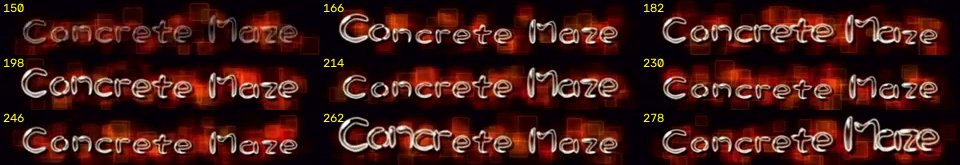
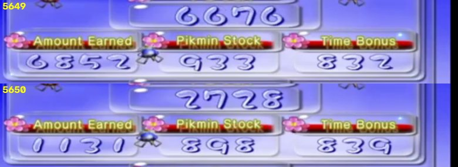

# Challenge Mode seeds from video

**Verdict: not feasible with the falling-letter method; feasible a different way, from the
results-screen score roll, for the first floor of every stage after the first.** Floors 2+ of a
stage, and the run's first stage, have no RNG readout in the video. The pre-stage menus don't
fill that gap either (§6).

## 1. What a challenge floor shows on entry

The same floor-title screen opens (cave name + "Sublevel N"), but the name **does not fall**. It
fades in at its final place, red flame particles burn around it, and the letters pulse in size in
place.

Measured on Concrete Maze 1 (frames 150–310, 480p): the letters' bottom edge stays on row 128 from
the first visible frame to the fade-out, and the top edge moves ±5 px with the pulse. A story-mode
title at this size falls about 120 px from the top of the screen.

Decomp (`pikmin2-decomp/src/plugProjectOgawaU/ogObjFloor.cpp`, `ObjFloor::doCreate`): story caves
(`isFLOOR()`) build their title as `TitleMsgDrop`, while challenge ids `c_00`–`c_29` (`isCHALLENGE()`)
build it as `TitleMsgWave` (the enum names in the decomp are swapped). `TitleMsgDrop::init` draws
`randFloat() * 5` per letter; `TitleMsgWave` (`ogTitleMsg.cpp`) never calls `rand()` (a sine wave
plus a `ScaleMgr`). Challenge mode reaches this screen through `VsGame` `LoadState::exec`
(`vsGS_Load.cpp`, `open_Floor` with id `c_%02d`), and the VS-only rule rand (`isVS()`) is skipped.
**So the challenge title carries no RNG information at all.** That is not a detector problem.

## 2. Does the existing detector run on it?

- `p2seeds analyze` on the first 4 minutes of the 2-player GC run finds all 5 title screens as entry
  candidates, but recognizes none of them (best story cave 0.36–0.38).
- `docs/challenge_mode_probe.py` adds the 30 challenge names. Then "Concrete Maze" (CH12) is
  recognized at 0.37 (runner-up "Cave of Pain" 0.28, so the margin is fine; the score is low
  because of the flame glow). The font is the same, so no new templates are needed. 9 of 13 letters
  track, but each moves at most 2–4 px (6.5 for "z") over about 100 frames. `fit` stops with
  "too few letters with a usable fall", as the decomp predicts.
- Both runs were repeated after merging `detection-page-and-tuning` (its new `track.py` pair
  tracking included), with identical results.

## 3. What does carry the RNG: the results-screen score roll

After a stage, `TChallengeResultCounter::update` (`plugProjectMorimuraU/challengeResult2D.cpp`)
rolls four counters: pokos, Pikmin, time bonus and total. Every frame, each digit not yet locked is
`randInt(9) + 1` from the global RNG, ones digit first, in that counter order. One clean frame
shows up to 14 consecutive draws. This is the same signal CaveGen's real-time challenge-mode manip
reads (`Seed.java` `digit_observation`, `sequence_to_seed`; `Manip.java`).

Read by eye from 480p VODs, then put through `java -cp CaveGen.jar Seed seq2seed`:

| run / frame | digits (draw order) | seed |
|---|---|---|
| 2P GC 6590 | 5817 187 562 6228 | `423CDA79` |
| 2P GC 6589 | 1537 861 333 2557 | its 14 draws sit directly before 6590's, with 1 misread digit |
| 2P GC 13500 / 13506 | 6336… / 6198… | `51D44787` / `5416C4D3`, **84 = 6 × 14 draws apart** |
| solo Wii U 5649 / 5650 | 2586 339 238 6766 / 1311 898 938 8272 | `0F26C79E` / `04047550`, **14 draws apart** |

Later frames, where only the total is still rolling, land in the same stream (4 draws per frame,
then 3, 2 and 1 as digits lock). That pins the draw where the roll ends: about 1090 draws after
`04047550` in the solo run, and about 1195 after `51D44787` in the 2P run.

## 4. Seed → floor-1 layout, checked with CaveGen3

As in CaveGen's manip, the next stage's floor-1 layout seed is
`roll_end + 1004 + k`, where k is the number of slow menu advances between the results fade and
starting the stage. Each advance takes 16–286 frames (`seed_duration`); the first takes
`seed_duration_first`.

Solo run ([tcbtrio, Wii U VC USA, 56:05](https://www.youtube.com/watch?v=0Wa5r0jQBAc)):
- The roll ends at stream index 1090: the last draw is the thousands digit '9' that appears at frame
  5763, and the display never changes after that.
- The stage was started about 120 frames after the results fade (black at 5838, stage fade at about
  5958). The first menu advance would come 192–269 frames after the fade, so k = 0.
- That predicts Cryptic Cavern 1 (CH11-1) = `04047550` + 2094 = **`8F129F12`**.

The video matches the prediction: the pod is alone in its room, and the far room has the doodlebug
high up near the hole and the diamond right of centre, below it, where the player sends Pikmin
(frame 6410). The neighbours differ visibly: +2092 has the diamond top-right by the hole, and +2093
has the doodlebug lower. CH11-1 is a simple floor (two rooms, one teki, one treasure), so this is
consistent evidence rather than proof. A multi-room floor would confirm it better.

Also: the two 2P results screens are only 28,058 draws apart across the 5-floor Cryptic Cavern
stage. Floors 2+ are bounded to a window that small, but the video gives no readout inside it.

## 5. What supporting it would take

1. **New event type**: detect the results screen (blue panel, "Results!") instead of the title.
2. **Digit reader**: about 10 digit templates for the results font. This is a slot-roll font, not
   the HUD digits; `digits.py` is a starting point. Read the four counters per frame, ones digit
   first; locked digits are skipped (not drawn) and must be recognized as locked.
3. **Seed search**: the digit observation is affine in the RNG, like the letters, so `lattice.py`
   can take digit intervals (width 1/9) instead of velocity intervals, or call CaveGen's `seq2seed`.
   Chain consecutive frames (exactly N draws apart) to confirm, as `chain.py` does.
4. **Roll end and menu timing**: track the roll until it locks, measure fade → stage start in game
   frames, and walk `seed_duration` to get k. Then the layout is `end + 1004 + k`.
5. **Cave table**: challenge ids `CH1`–`CH30` (CaveGen3 names them `CH11-1` etc. and generates them;
   `caves.py` needs English names for the stage order and labels, see the probe).
6. **Verification**: compare the landing view (CaveGen3 `--view pod`) with the video, since there is
   no second independent reading of the same seed. The ±2-draw uncertainty at the roll end means a
   few neighbours must be ranked.

Limits:
- No floor 2+ seeds.
- No seed for the run's first stage, which has no preceding results screen.
- 2-player runs are split screen (harder to verify, though the digits read the same).
- The solo run here is the Wii U VC release ("New Play Control!" in its splits). Its roll and
  CaveGen3's `pikmin2` data agreed on this floor.

## 6. RNG on the menus before a stage is picked

The question: can something on the title screen, file select or challenge stage select read the
RNG for the stages the results roll can't cover (the run's first stage, floors 2+)?

**Verdict: no.** The menus advance the global RNG, but only two things there carry real
information. The stage-select flash timer gives about 8 bits per flash, and a runner sees 0–1
flashes per visit. The stage-confirm Pikmin dive makes 1000 draws but can't be read at VOD
resolution. Neither pins a seed. The decomp does explain CaveGen's "+1004", which confirms the
menu → floor-1 link used in §4.

### Seeding

`System::construct` calls `srand(OSGetTick())` at power-on (`sysGCU/system.cpp:421`). Nothing
reseeds afterwards: no `srand` on file load, on entering Challenge Mode, or per stage (the only
other `srand` is the memory-card unlock's private LCG, `Dolphin/card/CARDUnlock.c`). So the RNG
carries over through everything since boot, including all gameplay.

### Per screen

| screen | global-RNG draws while showing (decomp) | visible? | verdict |
|---|---|---|---|
| Boot | `srand(OSGetTick())` | no | unknowable |
| Title / Press Start | `ebiScreenPushStart.cpp:142` one `randEbisawaFloat` per loop (picks 1 of 4 screens, 2 bits). Title-scene Pikmin `ebiP2TitlePikmin.cpp:518–541,665`, Chappy `ebiP2TitleChappy.cpp:211–227`, Kogane `ebiP2TitleKogane.cpp:192–204` and `ebiP2Title.cpp:193,548,571,732` draw on spawn and on each AI state change (speeds, wait timers, turn angles) | yes, dozens of small agents on a chaotic simulation | not readable in practice; also not in run footage (see below) |
| Title menu | `ebiScreenTitleMenu.cpp:308`: one draw per highlight cycle, `< 0.2` shows a sparkle (about 0.7 bits) | yes | far too little information |
| File select | none (`ebiFileSelectMgr.cpp`, `ebiScreenFileSelect*.cpp` have no `rand`); Challenge Mode does not go through it | — | nothing to read |
| Challenge stage select, created | `TChallengeSelect::doCreate` (`plugProjectMorimuraU/challengeSelect2D.cpp:1387,1402`): `TChallengePlayModeScreen` ctor 3 draws (`mAngleTimers`, the "Pick one!" swing phases, :680), then `TChallengeScreen` ctor 1 draw (first flash delay `300·r` frames, :518) | swing phase: only during "Pick one!", about 20 frames | not enough |
| Challenge stage select, idle | `TChallengeScreen::update` (:600–620): after each highlight flash, the next delay is `300·(0.9r + 0.1)` frames, one draw per flash. This is exactly CaveGen's `seed_duration` / `seed_duration_first` (`Seed.java:628–635`) | the highlight on the stage panels (`Nhl_00`–`Nhl_14`) | about 8.1 bits per frame-timed flash (270 possible delays); pinning 31 bits needs about 4 consecutive flash gaps, which is 20+ s idle on the menu |
| Stage confirm (dive) | `TChallengeSelect::jumpStart` → `TChallengePiki::jumpStart` (:75–96): 5 colours × 50 Pikmin × 4 `randFloat` (start delay 0–0.1 s, x deviation ±30 units, its sign, y deviation 15–25) = **1000 draws** | in theory | lots of information, but not readable from these videos (below) |

### What the footage shows

- **Neither run shows a title screen or file select.** The solo video opens on "Continue / Give Up"
  from an earlier attempt (frames 0–30) and goes straight to the stage select (frame 100). The 2P
  video opens on the stage select. A run's first stage therefore follows a give-up, after gameplay,
  so the RNG at that point is unknown.
- **Time on the stage select is about 4 s per visit.**
  - Solo, after stage 1: the results fade out at 5838, the menu is visible at 5850, the cursor moves
    and A is pressed at about 5866, "Pick one!" shows 5869–5888, the dive runs 5895–5955, and the
    stage starts at 5964.
  - Solo, run start: menu at 100, "Pick one!" 115–135, dive 136–200.
  - 2P before Snack Pit: menu fades in about 13716, "Pick one!" about 13746–13764, dive 13770–13836.
  - So the panel is on screen for about 45–60 frames before A. The first flash comes `300·r` frames
    after the menu is built, so a typical visit shows 0 flashes, sometimes 1.
- **No flash was seen.** In the 2P Snack Pit visit, the known seed puts the first flash 107 frames
  after the menu was built (about frame 13817, during the dive). No change shows on the flower grid
  in frames 13796–13840, and the solo menu visits show none in the grid-brightness trace. The
  highlight is subtle at 360/480p (the solo VOD is 640×360). Even a visible flash gives one 8-bit
  reading.
- **The dive is not readable.** The Pikmin are about 6 px tall and fly in tight single-file queues
  per colour, overlapping (solo frames 5900–5952, 2P frames 13796–13836). The start delay (≤ 3
  frames) and ±30-unit scatter of one Pikmin can't be separated from its neighbours'. A clean,
  full-resolution capture might do it: 1000 draws ending exactly at floor-1 generation would pin
  the seed with no timing involved. That would be its own research project, and these VODs can't
  support it.

### Menu → floor 1 (this confirms §4)

From the results roll's end L, in order: the menu is built (4 draws: 3 swing phases + first flash
delay), then k flash draws, then the dive (1000). Floor 1 is generated from **L + 4 + k + 1000**,
which is CaveGen's `next_seed(lastReadSeed, 1004)` with timer seed `L + 4`. The CH11-1 check in §4
(k = 0, `8F129F12`) is this chain. One unchecked case: a flash timer that runs out during the dive
(as predicted for the 2P Snack Pit visit) would make its draw after the dive's, if
`TChallengeScreen::update` keeps running in the demo. That would shift floor 1 by +1. Rank ±1
candidates when that happens.

### What stays out of reach

- The run's first stage: it follows a give-up, and the only readout before it is the unreadable
  dive.
- Floors 2+: no menu between floors.

## Footage used

- 2P GC USA: [tcbtrio, CurtisDN_ 59:25](https://www.youtube.com/watch?v=GJhM7TEK0bY) (speedrun.com
  "Challenge Mode All Levels", #13), first 8 min and full video at 480p30.
- Solo Wii U VC USA: [tcbtrio 56:05](https://www.youtube.com/watch?v=0Wa5r0jQBAc) (#4), full video
  at 480p30.

Downloads are in `data/challenge/` (gitignored). The CaveGen3 candidate renders are in
`data/challenge/cand*`.
