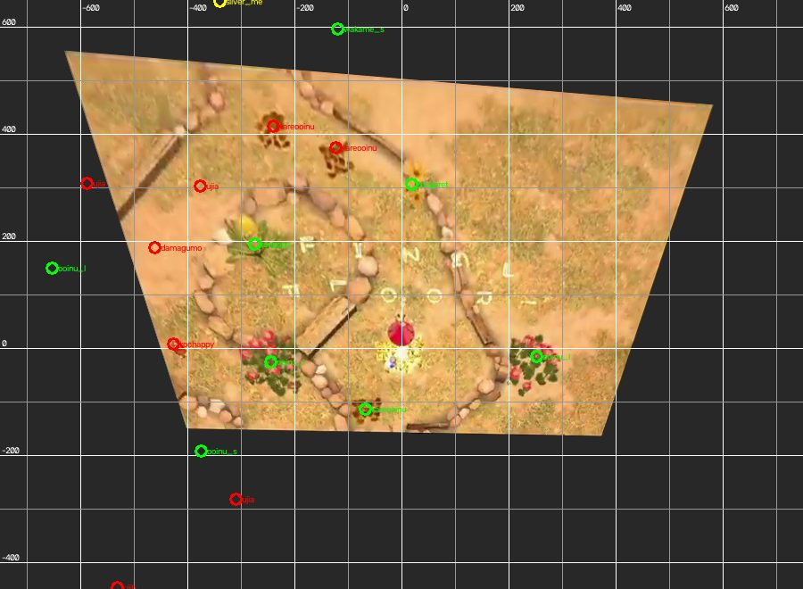
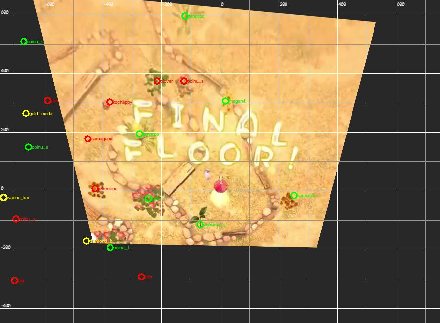
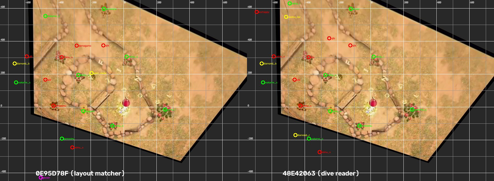
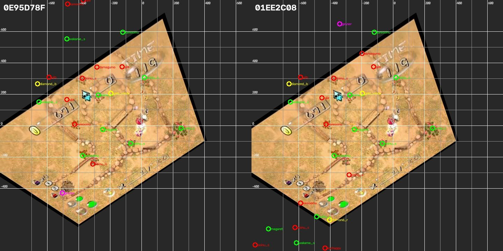

# Layout matcher: a stage's seed from the layout seen in the video

**Verdict: practical for single-floor score-attack records, with an agent reading about ten
objects from one rectified frame.** On Twilight Garden (CH10-1):

- **Blind test** (cmal08, a GameCube run whose seed is known from its results roll): 9 objects read
  from the "FINAL FLOOR!" fly-over cut 1,000,000 candidate seeds to 10. Inside the draw-rate window
  (about 50,000 seeds) **the true seed was the only survivor.** One of 10 readings was wrong (a
  dandelion at the edge of the view read as a shoot).
- **CH10 world record** (Gorei_50, 26,773): the same method gives **`0E95D78F`** (stage seed 45,229
  draws before the results roll). An end-of-run frame confirms it: the geyser sits where this
  layout puts it.
- **The dive reader's candidates are wrong.** `48E42063` and `302A5EC7` each pass only 2 of the 9
  observations. At the spots where the video shows a big red figwort and a gold coin, `48E42063` has
  a shoot and nothing.

The matcher handles the layout side. Two parts are still agent-in-the-loop: reading plant and
treasure types off the rectified image, and confirming between "families" of near-identical seeds
a few draws apart.

## 1. The window

The stage's floor-1 seed is k draws before the first state of the results roll that follows it
(the roll reader gives that state). k = frames from the dive to the roll × draws per frame.

| case | frames, dive → roll | true k | draws/frame | CMAL rate for the stage (6 runs) |
|---|---|---|---|---|
| CH28 WR (spark573; truth from the previous attempt's roll) | 7,300 | 91,975 | 12.6 | 11.7–16.9 |
| cmal04 CH10 (tcbtrio) | 1,569 | 47,932 | 30.5 | 26.4–34.4 |
| cmal08 CH10 (JackDraz) | 1,716 | 48,993 | 28.6 | 26.4–34.4 |
| **CH10 WR (Gorei_50)** | 2,679 | **45,229** (this report) | **16.9** | 26.4–34.4 |

- **The real windows are tens of thousands of seeds, not millions.** A single-floor stage with
  100k draws in total can't hide its seed among 6M. The 6M span in `run_wrs.py` was a safety bound
  (from an unverified ~230 draws/frame read on CH1).
- **Record play can draw less RNG per frame than CMAL play.** The CH10 record ran at 16.9
  draws/frame, below the ±35% band around the CMAL rates (17.2–46.4). That band would have missed it
  by 800 draws. Use a looser band (×0.5 to ×1.5 of the CMAL range: about 35k–140k seeds for CH10)
  and scan a wide range anyway (below).
- **Speed:** CaveGen3 generates and checks about 10,000 CH10-1 layouts per second on this machine
  (shared with other jobs), so 1M seeds take about 1.5 minutes. Scanning [0, 1M) instead of only
  the rate window costs almost nothing and shows whether the window was right.

## 2. What the video shows, and which features carry information

**Twilight Garden 1: the pod always lands at the same place.** In every layout of 1M checked, the
pod is at spawn point 0 of the first unit, `room_5x5a_2_kusachi`. So the stones, logs and island
around the pod are identical in every layout and in every video. That matters twice:

- they carry no information;
- they make a fixed reference for calibrating the camera.

What varies near the pod is which **plant** occupies each plant spot, and where the treasures and
teki go. Information per feature (bits, over 1M seeds, positions rounded to 20 units):

| feature | distinct positions | bits |
|---|---|---|
| any one treasure (5 kinds) | 21 spots | 3.6–4.2 each |
| Beady Long Legs (Damagumo) | 893 | 8.8 |
| geyser | 10 | 3.2 |
| nearest dandelion (Tanpopo) | 52 | 4.9 |
| nearest Margaret | 44 | 3.6 |
| Damagumo + all 5 treasures (joint) | 578,691 combinations | 18.8 |

The window holds about 15–17 bits. A few plants plus one treasure position are enough, and they are
on screen right after landing. Damagumo and the sheargrubs are not: Damagumo drops from above when
approached, and sheargrubs are buried.

**The "FINAL FLOOR!" fly-over.** On a stage's last floor (every single-floor score stage), the
camera rises behind the pod and looks down on the pod's room for about two seconds (cmal04 frames
80380–80440; record frames ~520–560). It is the best view of the start: high, nearly top-down, no
HUD, and the floating title text covers only part of it.

**Plant vocabulary** (learned on the known seed, see §4):

| looks like | CaveGen3 name |
|---|---|
| big red-flowered bush | `ooinu_l` (Figwort) |
| small red-flowered plant | `ooinu_s` |
| brown withered plant | `kareooinu_s` |
| yellow puff with long leaves | `tanpopo` |
| small yellow-orange daisy | `magaret` |
| two-leaf sprout | `wakame_s` |
| green three-leaf | `clover` |

My first guess before calibrating ("Margaret" for the red bushes) was wrong. Learning the names
against a known seed is necessary.

## 3. Pipeline (`docs/layout_matcher/`, `p2seeds/cg3/src/bin/layoutmatch.rs`)

1. **`layoutmatch` (Rust, on CaveGen3):**
   - `dump SUB SEED` gives every object in the **pod's frame**: `ahead` along the pod's facing,
     `side` to its right on screen.
   - `scan SUB END COUNT OBS.json OUT.bin` checks every seed k draws before END against a list of
     observations ("an object named one of N within T units of (ahead, side)", "none within r",
     "pod at spawn point i"). It writes one bitmask per seed.
   - `feat` dumps nearest positions per object, for the bit counts above.
   - Build: `docs/layout_matcher/build.sh`.
2. **Calibration, once per sublevel, on a known seed** (`calib.py`): mark 6–9 objects of the known
   layout in one fly-over frame and fit a homography from pod-frame floor coordinates to pixels.
   - On cmal04 frame 80388 the 9 residuals are 1–18 px at 1280×720, about 10–20 game units.
   - `refs.py build` then registers the neighbouring fly-over frames (80380–80440) to it, giving 16
     calibrated reference frames.
3. **Registration of a new video** (`register.py`, `refs.py match`): SIFT on the fixed room against
   the reference frames, best match wins, HUD masked.
   - Works on the record (61 inliers) and on cmal08 (59).
   - Fails on cmal02, cmal11 and cmal26 (11–23 inliers). These are lower-resolution or 4:3
     captures, and their fly-over camera takes a different path, so their frames don't overlap the
     references well.
4. **Rectification** (`rectify.py`): warp the registered frame to a top-down pod-frame image with a
   100-unit grid. The agent reads each object's type and position off the grid (`obs/*.json`,
   tolerance 70–90 units).
5. **Filtering** (`match.py`): scan the window and report each observation's pass rate on its own,
   and the survivors after each step.
6. **Confirmation:** draw the survivors over rectified frames (`rectify.py ... SEED SUB`) and look
   for differences the fly-over did not cover (the geyser, here).

## 4. Known-seed tests

**cmal04, CH10** (`133A7DD6`): used for calibration, so not blind. All 9 marked objects matched
their CaveGen3 positions within 20 units, which validated both the homography and the plant
vocabulary.

**cmal08, CH10, blind** (`617945F2`; I read the observations before looking at the seed). Survivors
over k ∈ [0, 1M):

| observation (pod frame) | passes alone | survivors | truth |
|---|---|---|---|
| big red bush left (−25, −250) | 42% | 421,124 | ✓ |
| withered plant right | 12% | 54,225 | ✓ |
| shoot behind-left | 18% | 11,310 | ✓ |
| withered plant far left | 15% | 1,791 | ✓ |
| yellow puff ahead-left | 27% | 550 | ✓ |
| small yellow flower ahead | 27% | 143 | ✓ |
| green leafy plant ahead-left | 19% | 21 | ✓ |
| red flowers ahead-left | 29% | 11 | ✓ |
| red flowers far behind-left | 42% | 10 | ✓ |
| shoot far ahead (misread: it is a dandelion) | 18% | 1 | ✗ |

After the 9 correct readings, 10 seeds of 1M survive. Only one lies in the draw-rate window (k
29.5k–79.6k), and it is the truth (k = 48,993). Each plant observation keeps 12–42% of seeds, so
every good reading is worth 1.3–3 bits.

**CH28 WR** (`29549C67`, known): not attempted. Concrete Maze-style dark floor, a different pod
room, and no calibration for it.

## 5. The CH10 world record

Window: results roll at frame 2943, first state `7AF2AC00`; dive at frames 198–264. Nine
observations from the registered fly-over (frame 526, `obs/wr10_flyover.json`):

| observation | passes alone | survivors in [0, 1M) | survivors in the rate band 46k–124k |
|---|---|---|---|
| big red bush right of pod | 18% | 181,051 | 14,305 |
| red plant behind-left | 42% | 69,790 | 5,556 |
| red plant ahead | 42% | 24,109 | 1,884 |
| gold coin ahead-left (183, −192) | 11% | 2,496 | 179 |
| red plant ahead-left | 42% | 748 | 48 |
| red plant far ahead-left | 28% | 223 | 26 |
| withered plant left | 15% | 35 | 3 |
| yellow flower left | 27% | 11 | 1 |
| withered plant far ahead | 12% | **6** | **0** |

The 6 survivors come in "families": seeds a few draws apart share most of the RNG stream, so their
layouts agree almost everywhere.

| k | seed | draws/frame | geyser (pod frame) | verdict |
|---|---|---|---|---|
| 45,224 | `01EE2C08` | 16.9 | (647, −339) | ✗ geyser not where the video shows it |
| **45,229** | **`0E95D78F`** | 16.9 | (−429, −503) | **✓** |
| 303,390 | `4614F21E` | 113 | (664, −1330) | ✗ geyser |
| 804,716 | `375A0DDC` | 300 | (−180, −1432) | ✗ geyser |
| 981,743 / 981,746 | `1D0228A9` / `1DA265E2` | 366 | (−429, −503) | excluded by rate only (10–30× any measured rate) |

**Geyser check.** At the end of the run (frames 2380–2470), the pod, the big red bush and the geyser
are on screen together, and the frame registers to the pod room. `0E95D78F`'s geyser lands on the
crater in the video; `01EE2C08`'s is off-screen. A two-point fit on pod + bush in the TIME-120
frame (frame 2400) gives the same answer: predicted (54, 124) px against (75, 105) observed for
`0E95D78F`, and (249, −119) for `01EE2C08`.

**Dive reader cross-check** (`dive_check.py`, the grey reader's image loss with a geometry fit):

| seed | dive loss |
|---|---|
| `48E42063` (dive reader's pick) | 89,501 |
| `302A5EC7` | 90,786 |
| `0E95D78F` (this report) | 122,225 |
| `01EE2C08` | 121,574 |

The dive strongly prefers `48E42063`, whose layout contradicts the video at 7 of 9 points (wrong
plant kinds at fixed plant spots, and no treasure at the coin). The report already found the dive
unreliable on Gorei's Wii captures (CH10 wrong at a 23.6% margin before). So this is another dive
misread, not evidence against the layout.

What's left open: the `1D0228A9` family is excluded only by its draw rate. The gameplay frames
that show the blue diamond (`0E95D78F` puts it about 710 units ahead-left; `1D0228A9` about 1000
ahead) did not register reliably: the camera leaves the pod room, and HUD features dominate the
matches. Checking it by hand would close that gap.

## 6. How reliable was my image reading?

- **Object types:** reliable for big, distinctive plants once the vocabulary was calibrated: 18 of
  19 readings across cmal08 and the record are consistent with the final layouts. The miss was a
  plant at the edge of the warped view, where the image is stretched.
- **Positions read off the rectified grid:** within about 30–60 units, inside the 70-unit tolerance.
- **What I could not read:** buried or hidden teki, small items under the title text, and
  anything in the dark, low landing ("READY?") view. The landing camera in Challenge Mode is
  centred on the captain, not the pod, so `views.py`'s story-mode landing camera does not fit it.
  Use the fly-over instead.
- **Reading the raw, unrectified frame by eye is not reliable:** on the landing view I misjudged
  object depths badly. Rectifying first made it easy.
- **Cost:** about 10 objects and a few minutes per video, plus one look to confirm the survivors.

## 7. Practical for score-attack WRs?

**Yes, for single-floor stages with a lit, recognisable start.** Per stage:

- **Once per sublevel (agent, about 30 min):** find a run with a known seed (any CMAL run with a
  results roll before the stage), mark 6–9 objects, build the references, and learn the
  plant/treasure vocabulary.
- **Per record (mostly automatic):** window from the roll, registration, rectification, scan. The
  agent reads about 10 objects off one image, then checks the few surviving families on 1–2 later
  frames.
- **Works best where the pod's spawn is fixed by the sublevel** (one room type, as on CH10-1). If
  the pod can land in different rooms, calibrate each start room and add a "pod at spawn point i"
  observation (supported in `scan`).
- **Weak points:**
  - registration on low-resolution or 4:3 captures, which need references made from a capture of
    the same kind, or 4 hand-marked landmarks;
  - dark sublevels (CH28);
  - stages whose start shows few variable objects.
- **Families of seeds a few draws apart can't be separated near the pod.** That needs one feature
  further away (geyser, a treasure), so plan one confirmation frame per record.
- **Speed is not a constraint:** 1M layouts in about 1.5 minutes, so the window can be 10× generous.

Compared with the dive reader, this is independent of capture quality on the menu and gave the
right answer where the dive was confidently wrong. Using both remains useful: a dive state that
also matches the layout is very strong evidence.

## Files

- `p2seeds/cg3/src/bin/layoutmatch.rs`: dump, scan and feat.
- `docs/layout_matcher/`:
  - `lm.py`: wrappers;
  - `calib.py`, `register.py`, `refs.py`, `rectify.py`, `chain.py` (frame-to-frame chaining: drifts
    under the title text and HUD, not used for results);
  - `match.py`, `overlay.py`, `dive_check.py`, `build.sh`.
- `docs/layout_matcher/obs/`:
  - the CH10-1 fly-over calibration (`H_ch10_finalfloor.json`, reference frame `cmal04_ch10_f80388.jpg`, marked pairs);
  - the observation files for cmal08 and the record.
- Data (gitignored, `data/lm/`): references built from cmal04 frames 80380–80440, scan bitmasks,
  logs.

## 8. Extending to every Challenge Mode record (attempt, Nov 2026)

**Result: no new seeds yet.** CH10 (`0E95D78F`) is still the only record solved. The per-sublevel
method in §3 works, but it does not carry over between stages, and the calibration-free shortcut
tried below separates seeds only on some stages.

**Inventory** (`inventory.py`, `known_seeds.py`):

| status | stages |
|---|---|
| results roll and dive found | 25 records |
| no dive found, but the floor-1 comedown is in the video | CH13, CH18 |
| impossible | CH21 (the video starts on floor 2), CH23 (no video) |
| no decoded roll, so no window | CH27 |

- On most sublevels the pod's start is fixed: 23 of 29 have one start room and spawn point.
- The CMAL runs give **168 stage starts with known floor-1 seeds**: every stage, in up to 7 runs.
  That is enough ground truth to calibrate and test each sublevel.

**Fly-over calibration is per sublevel.** The "FINAL FLOOR!" camera path transfers between players
on CH10, but Snack Pit's (CH16) path is different. CH29, a variant of CH10's room, does not
register to CH10's references. Each single-floor stage needs its own calibration on a known seed.

**Comedown floor matcher** (`comedown.py`, `floormatch2.py`, `layoutmatch floor2`):

- **The idea:** the overhead shot under the floor title is the same cutscene on every floor, and
  its camera is known from CaveGen3 (`COMEDOWN_CAMERA`). Lit floor stands out against black, so
  every candidate's unit footprint can be scored against it automatically, fitting zoom and turn
  per seed. There is no agent reading. Scoring 300k seeds takes about 5 minutes.
- **Camera:** the shot is closer than CaveGen3's frame-0 model.

  | case | zoom | turn |
  |---|---|---|
  | cmal04 CH8 | 1.1 | −1° |
  | CH10 record | 1.58 | −6° |
  | CH2 | no consistent fit | |

  The zoom probably depends on the floor height relative to the cutscene's anchor. The CH10 record
  and the CH28 record (known seed) both line up under the CH10 values.
- **Where it works:** on cmal04's Red Chasm (CH8, known seed) the true seed ranks **first of
  300,000**, tied with 6 seeds that have the same floor shape in view.
- **Where it doesn't:**
  - CH1, CH5 and CH9: only the pod's own room is lit, and it is the same in every layout, so every
    seed scores the same.
  - CH28 (dark): truth ranked 3,624th of 300k.
  - CH2, cmal04 known seed: truth ranked 32,124th of 100k, at any turn. The known layout (three
    rooms in a straight column) doesn't resemble the video. Either something is off in CaveGen3's
    CH2-1 for this release, or in how the shot is centred. Not resolved.
  - On the records run so far (CH1, 2, 5, 6, 8, 9) no stage gave a clear winner.

**What it would take.** Per stage, roughly 30–60 minutes of agent work, as on CH10:

1. Calibrate the stage's fly-over (single-floor stages) or landing view (multi-floor stages) on a
   CMAL run with a known seed.
2. Register the record's frames to that calibration.
3. Read about 10 objects and scan the window.
4. Confirm the survivors on a later frame.

Bright stages with many distinct plants and treasures near the pod (gardens: CH4, CH17, CH26; tiled
rooms: CH20, CH22) are the best candidates. Dark stages (CH16, CH28, CH29) and stages where the
start shows only the fixed pod room are the hardest. The comedown floor score is still useful there
as a cheap pre-filter: it costs nothing to run and on CH8 it kept the truth in the top 7 of 300k.

New tooling:
- `comedown.py`, `cd_overlay.py`, `fp_overlay.py`, `fit_comedown.py`;
- `floormatch.py` / `floormatch2.py` and layoutmatch `floor` / `floor2`;
- `calib_view.py`, which helps mark calibration objects, optionally in the 110° landing-camera
  frame;
- `wr_comedown.py`, `run_floor_wrs.py`;
- `obs/comedown_frames.json` (comedown frames picked for 27 records).

### 8.1 Bright stages, per-stage attempts

| stage | result | confidence |
|---|---|---|
| CH10 Twilight Garden | `0E95D78F` | confirmed (§5) |
| CH20 Giant's Bath (2 floors, Wii) | `5D221DD2`, k = 191,595 | confirmed by the user; the only fit in k 0–1.2M |
| CH14 Dweevil Nest (1 floor, Wii) | `246C1C78`, k = 136,736 (42.5 draws/frame, CMAL 39.5–63.3) | strong: the only seed fitting all 9 readings in k 0–600k |
| CH17 Three Color Training | family `25835E4D` / `1C8189E4` (identical layouts), k = 119,870 | weak: suggestive only |
| CH4 Creator's Garden | none | calibration failed |
| CH22 Subterranean Lair | none | too few readable features |

- **CH20, first attempt** (comedown floor matcher plus objects, `obs/ch20_comedown.json`): the
  floor shape left 1,885 of 600k seeds, four objects read off the comedown left 10, five of them
  in the rate window. All five were wrong. Two of the readings were misreads: the "hole in the
  bottom-right cap" was the Sud Generator (soap) in a pipe end, and the "treasure in the top-left
  cap" was the bare pipe end.
- **CH20, second attempt** (treasures only, identified in gameplay; `obs/ch20_treasures.json`):
  - Enemies aren't drawn during the comedown. Each cutscene has draw flags for Pikmin, captains,
    treasures and enemies (`MoviePlayer::setPauseAndDraw`), and in this video treasures show but
    enemies don't. So only treasures are used.
  - Gameplay frames 1750–1930 show three pipe ends around the lower room: the duck on one wall,
    then round the corner the soap and the bell on the next wall. The comedown places the duck
    and the soap at pod-frame (ahead −200, side 880) and (−720, 870), with a gold treasure in the
    lower pool at (−480, 390).
  - Those four observations leave 86 of 4M seeds (k 0–4M). Within k 0–1.2M only `5D221DD2`
    (k = 191,595, inside the rate window) also has the exact comedown floor shape. The next exact
    shape matches are at k ≥ 1,199,536.
  - Checked on gameplay. Predicted and seen: in the duck room's pool, two treasures and a Hermit
    Crawmad burrow; a second burrow by the duck's pipe end; an egg in the pipe end next to the pod
    (frames 920–1000). The other exact-shape seeds have no eggs and one treasure in that pool.
  - Not checked: the hole (predicted in the pipe end behind the pod, (−813, 0)) and floor 2.
  - Images: `data/lm/ch20_review/` (`check_5D221DD2.jpg`, `gp/`), not committed.
  - Viewer: https://jhawk4.github.io/CaveGen3/?sublevel=pikmin2:CH20-1&seed=5D221DD2
- **Method for single-room stages** (CH14): the pod's room is fixed, so each treasure can only be
  at a few spots in the pod's frame.
  - `spots.py` lists the spots from 1,000 sampled seeds.
  - `fit_spots.py` fits the comedown camera (zoom, turn, shift) by snapping the treasures marked
    on the frame to spots.
  - `spot_overlay.py` numbers the spots on the frame; crops of each spot over several frames,
    next to CaveGen3's icons, give the identities.
  - `compare.py` puts the frame next to CaveGen3's comedown render of a candidate.
- **CH14** (`obs/ch14_hard.json`; comedown frame 334, camera zoom 1.35, turn −2, shift 100,0):
  - 12 spots: 9 at the arm mouths on a ring 680 from the pod, 3 inner.
  - Hard readings: Key at spot 1, Combustion Berry at inner spot 9, feather (bird_hane) at inner
    spot 10 leave 798 of 600k. Spot 3 empty and the Colossal Fossil (skull) at spot 7 leave 13.
  - Soft readings: cat figure at spot 2, chocolate cup at spot 6, small yellow bobber at spot 4,
    and a shuttlecock (round spiky ring from above) at spot 8. Only `246C1C78` fits all four,
    and its comedown render matches the frame object for object.
  - Not checked in gameplay beyond the comedown; spots 0 and 5 (behind the title, off screen)
    are predicted to hold the blue toy ring and the Paradoxical Enigma.
  - Viewer: https://jhawk4.github.io/CaveGen3/?sublevel=pikmin2:CH14-1&seed=246C1C78
- **CH17** (fork; fly-over calibrated on cmal04 `3CB60D07` from 3 objects; the record registered
  by hand on 6 fence and block points; `obs/ch17_*`):
  - Four observations leave 14 seeds in k 0–400k (about 9 families). Only one family falls in the
    rate band, at 24.0 draws/frame (CMAL 24.8–29.8).
  - The observations carry about 15 bits against a window of about 17, so landing on one family
    in the band is suggestive, not proof.
  - Next check: the egg at (−163, −559) and the Flame Tiller at (−163, 643) in early gameplay.
- **CH4** (fork): the known seed `29FFCAF0` doesn't fit cmal04's own fly-over. The render puts the
  pond behind the pod and the geyser ahead-left, but the video shows both up-left. The fly-over
  camera path also differs in each of the three videos.
- **CH22:** within 900 units of the pod there are only 3 Bulbears, and they wander before the
  fly-over. There is too little to read.

**Open data problem.** On cmal04, the known-seed layouts for CH2 and CH4 don't resemble the video,
while CH8 and CH10 match. These seeds come from the previous results roll, + 1004 draws, assuming
no menu flash. For CH2 the dive reader confirmed that state, and seeds ±5,000 draws around it don't
match either. So the cause is more likely a CaveGen3 difference for some challenge sublevels in
this release, or a different seed-to-floor link on those stages, than a misread. Until this is
explained, a layout-matched seed on any stage should be checked against one known-seed CMAL run of
the same stage.
