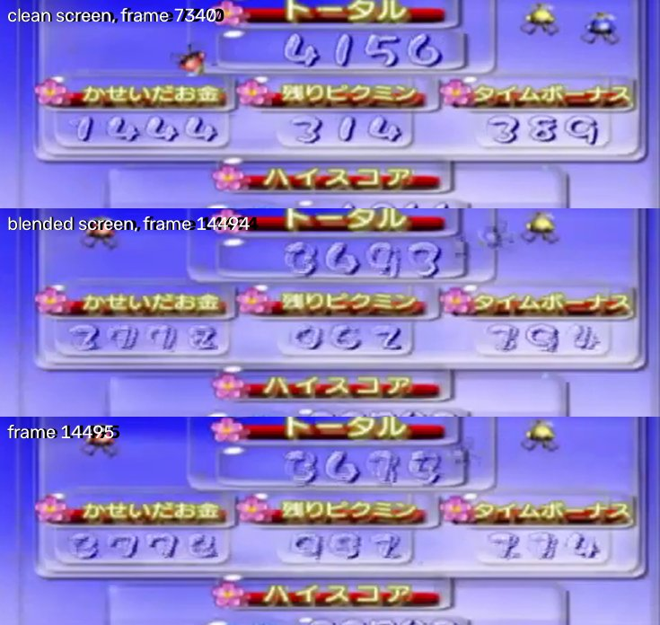

# Challenge Mode seeds from Wii (New Play Control!) videos

**Verdict: works, with one change, now made.** The Wii release's results-screen score roll looks
and behaves exactly like the Wii U VC one (same font and layout, same RNG, same 14 draws per game
frame in the same order, 30 game frames per second), so the existing templates and seed search
apply unchanged. What differs is the **capture**: many Wii captures blend the two fields of the
interlaced signal, so on about half of a video's results screens every video frame is a 50/50
overlay of two consecutive game frames. The stock reader can't solve those screens. The reader now
detects blended screens and reads them as digit pairs (`challenge_results.py`, §3).

| run (speedrun.com, Wii platform) | capture | results screens | stock reader | with blend support |
|---|---|---|---|---|
| spark573, CMAL, JPN ([video](https://youtu.be/QwI3y9XS6V4)) | 360p30, field-blended | 30 (16 blended) | 14 | **29** (1 lost track) |
| albut3, CMAT ([video](https://www.youtube.com/watch?v=zR9ZVK0IFQ0)) | 360p30, field-blended, repeats frames | 30 (20 blended) | 10 | **28** (1 lost track, 1 cut off at the video's end) |
| AEther_02_ + Noubeiy7, CMAL 2P, EUR PAL ([video](https://youtu.be/wVGtGZ4mkis)) | 360p30, clean | 30 (0 blended) | **30** | 30 |
| Noamoa, CMAL, JPN ([video](https://www.youtube.com/watch?v=BdgsGNMufro)) | camera pointed at a TV, **10 fps** | none registered | — | — |
| Squeachu, CMAL, EUR (Twitch) | VOD deleted (HTTP 403) | — | — | — |

Speedrun.com's "Wii" console value covers both real Wii and Wii U VC; the run's `system.platform`
field tells them apart (`v06dk3e4` Wii, `v06dr394` Wii U Virtual Console). The table lists the
CMAL and CMAT runs whose platform is Wii and that have a video. cmal09 in the Challenge Mode report
(`docs/challenge-mode-seeds.md` §8, "only 14 of 30 decoded") is the spark573 run above; its missing
screens were all blended ones.

## 1. Same game, same roll

The Wii U VC release runs the Wii New Play Control! build, so the only open questions were the
capture and the region. Measured on the videos above:

- **Font and layout:** identical to the Wii U VC captures. The GC/Wii U digit templates in
  `data/challenge_digits/` match without new templates (best-digit NCC 0.85–0.95 on clean frames).
  16:9 is handled by the reader's anisotropic registration (fitted x/y scale 1.096/1.081 for spark573,
  1.088/1.075 for albut3, 1.150/1.000 for the PAL run).
- **RNG and draw order:** unchanged. Every decoded clean screen follows `randInt(9) + 1` per unlocked
  digit, ones digit first, pokos → Pikmin → time → total, from the GC/Wii global RNG. Consecutive
  video frames land exactly 14 draws apart while all digits roll, e.g. spark573 frames 7335 →
  7336 → 7337: `369EDA64`, `43BE3EA6`, `2F930518` = +14, +28 draws. Clean-screen digit mismatch
  rate is 2.3–2.8%, the same as the GC and Wii U runs.
- **Frame rate:** one game frame per video frame at 30 fps. The PAL 2P run (EUR) also shows no
  repeated frames and steps of 14 draws (with the odd dropped frame, a step of 28), so it was played
  in 60 Hz mode. No 50 Hz Wii run with a usable video was found, so 25 Hz play is untested; the
  tracker would see it as regular repeated frames, which it already models.
- **Region:** the JPN and EUR copies behave the same as the USA Wii U VC copy.

## 2. The blended captures



On a blended screen every digit shows two values at once. The pattern holds for a whole screen and
changes between screens of the same video (spark573: screens 7335 and 22233 clean, 14487 and 16953
blended), because the game's 30 Hz frames fall either on a field pair or across two. The 720p60
version of spark573's upload doesn't help: it shows each blended picture twice (checked at frames
500–515 of a clip around the 14487 screen). The blend is in the capture, not the upload.

**A blended frame still pins the seed.** Read each slot as an unordered pair {digit at game frame g,
digit at g+1}. Video frame k then constrains draws q and q+14 of game frame g. A brute force over
all 2³¹ states (numba) with two frames finds exactly one state. On spark573's 14487 screen, the
state solved at frame 14490 is `0EE78637`. It matches 11–14 of the 14 digit pairs on each of the
next 10 frames (a random state matches about 0.3) and lies exactly 42 draws (3 frames × 14) after
the anchor the reader finds at the screen's first frame, `6D1C08B9`. On albut3's 8628 screen, the
experiment's state at 8624, `473F7A08`, lies 98 draws (7 game frames over 8 video frames, one of
them repeated) before the reader's anchor at 8632, `227D0FE6`.

## 3. Reader change (`p2seeds/src/p2seeds/challenge_results.py`)

- **Detection:** per screen, `blend_gain` = how much better 50/50 pair templates fit the digits than
  single digits (median over the first frames). Clean screens give 0.00; blended screens
  0.086–0.119. The threshold is 0.04.
- **Pair reading:** `read_pairs` scores all digit pairs from the single-template dot products
  (NCC with `ta + tb` = (w·ta + w·tb) / |ta + tb|), so it costs about the same as the single read.
- **Anchor:** `solve_blended` brute-forces 2³¹ states against two successive frames' pairs (all
  digits rolling, up to 6 misread slots; the first frame's first 3 slots must be read right, which
  keeps it to about 5 s). `find_anchor_blend` tries up to 6 frame pairs, skips repeats, and confirms
  the state on the next 6 frames, allowing repeated and dropped frames.
- **Tracking:** the same Viterbi search (`track`), with a blended emission: video frame k shows game
  frame g (RNG position p, locks k) and g+1 (position p + draws, locks after this frame's locks).
  The roll end therefore comes out as for clean screens (`state_after_last_draw`).
- **Quality:** blended tracks run at 16–25% mismatched digits (clean: 2–3%). Most mismatches are in
  the lock phase, where a slot blends a rolling digit with its final value. A blended screen above
  30% is reported as not decoded ("blended track lost"); that caught the two lost tracks above
  (59% and 80%).
- Clean captures are unaffected: the cmal04 reference screen (frame 5640) gives `blend_gain` 0.000
  and the same anchor, end state and match counts as before.
- Also: `read_results(start=, end=)` / `read_results.py --start --end` for a frame range, 720p+
  input is downscaled to 360p, and `docs/wii/reread_failed.py` re-reads only the screens a previous
  run could not decode.

## 4. Cross-check

CROSSCHECK

## 5. Story mode (note only)

The story-mode entry screen on Wii is the Wii U VC one, which `EVALUATION_AT.md` already looked at:
the name is stretched by 16:9, the screen fades out before the letters land, and a swirl effect
covers much of the name, so only 2–3 letters per entry could be tracked. Blended captures would add
a double image of each falling letter. A pair model like the one here would apply (each frame =
mean of two letter positions one game frame apart), but the fade and the swirl are the bigger
problems. No story-mode pipeline work was done here.

## Data

Downloads, roll JSONs and logs are in `data/wii/` (gitignored): `videos/`, `rolls/` (stock reads,
`*_blend.json` after the blend reread), `look/` (frame crops), `clips/spark_60_475.mp4` (the 720p60
clip).

```bash
# a whole video
.venv/Scripts/python docs/challenge_dive/read_results.py VIDEO --frames --out rolls.json
# only the screens an earlier run failed on
.venv/Scripts/python docs/wii/reread_failed.py VIDEO rolls.json rolls_blend.json
```
